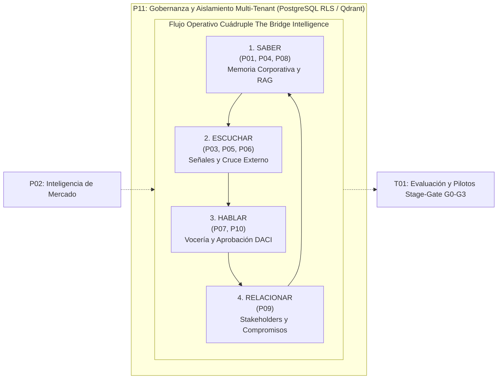

# Índice Global y Síntesis Transversal del Programa de Investigación
## The Bridge Intelligence — Plataforma de Inteligencia para Asuntos Corporativos

---

### Resumen Ejecutivo y Estado de Finalización
El presente documento consolida los resultados del programa integral de investigación estructurado sobre los 12 cuadernos canónicos de NotebookLM. Establece la arquitectura técnica, las compuertas de decisión empírica y la síntesis transversal requerida para diseñar, comercializar y operar **The Bridge Intelligence** (`thebridgeintelligence.ai`) bajo los estándares más exigentes de ciberseguridad, precisión factual y gobernanza de la información.

---

## 1. Mapa Canónico de los 12 Cuadernos del Programa
| Código | Nombre Canónico del Cuaderno | Alcance Preguntas | Fuentes Manifiesto | Manifiesto | Respuestas | Síntesis Analítica |
| :--- | :--- | :---: | :---: | :--- | :--- | :--- |
| **P01** | Usuarios, problemas y decisiones en asuntos corporativos | **64 IDs** (48F + 16C + 0X) | 39 fuentes | [`fuentes/P01.json`](file:///Users/fmillar/Proyectos_Desarrollo/BRIDGE/fuentes/P01.json) | [`respuestas/P01.jsonl`](file:///Users/fmillar/Proyectos_Desarrollo/BRIDGE/respuestas/P01.jsonl) | [`sintesis/P01.md`](file:///Users/fmillar/Proyectos_Desarrollo/BRIDGE/sintesis/P01.md) |
| **P02** | Panorama de soluciones y mercado | **96 IDs** (48F + 16C + 32X) | 80 fuentes | [`fuentes/P02.json`](file:///Users/fmillar/Proyectos_Desarrollo/BRIDGE/fuentes/P02.json) | [`respuestas/P02.jsonl`](file:///Users/fmillar/Proyectos_Desarrollo/BRIDGE/respuestas/P02.jsonl) | [`sintesis/P02.md`](file:///Users/fmillar/Proyectos_Desarrollo/BRIDGE/sintesis/P02.md) |
| **P03** | Captura de señales externas y monitoreo de entorno | **64 IDs** (48F + 16C + 0X) | 33 fuentes | [`fuentes/P03.json`](file:///Users/fmillar/Proyectos_Desarrollo/BRIDGE/fuentes/P03.json) | [`respuestas/P03.jsonl`](file:///Users/fmillar/Proyectos_Desarrollo/BRIDGE/respuestas/P03.jsonl) | [`sintesis/P03.md`](file:///Users/fmillar/Proyectos_Desarrollo/BRIDGE/sintesis/P03.md) |
| **P04** | Memoria corporativa y conocimiento interno | **64 IDs** (48F + 16C + 0X) | 34 fuentes | [`fuentes/P04.json`](file:///Users/fmillar/Proyectos_Desarrollo/BRIDGE/fuentes/P04.json) | [`respuestas/P04.jsonl`](file:///Users/fmillar/Proyectos_Desarrollo/BRIDGE/respuestas/P04.jsonl) | [`sintesis/P04.md`](file:///Users/fmillar/Proyectos_Desarrollo/BRIDGE/sintesis/P04.md) |
| **P05** | Riesgos, reputación y materialidad | **64 IDs** (48F + 16C + 0X) | 36 fuentes | [`fuentes/P05.json`](file:///Users/fmillar/Proyectos_Desarrollo/BRIDGE/fuentes/P05.json) | [`respuestas/P05.jsonl`](file:///Users/fmillar/Proyectos_Desarrollo/BRIDGE/respuestas/P05.jsonl) | [`sintesis/P05.md`](file:///Users/fmillar/Proyectos_Desarrollo/BRIDGE/sintesis/P05.md) |
| **P06** | Cruce de conocimiento interno y señales externas | **96 IDs** (48F + 16C + 32X) | 38 fuentes | [`fuentes/P06.json`](file:///Users/fmillar/Proyectos_Desarrollo/BRIDGE/fuentes/P06.json) | [`respuestas/P06.jsonl`](file:///Users/fmillar/Proyectos_Desarrollo/BRIDGE/respuestas/P06.jsonl) | [`sintesis/P06.md`](file:///Users/fmillar/Proyectos_Desarrollo/BRIDGE/sintesis/P06.md) |
| **P07** | Preparación ejecutiva y apoyo estratégico | **64 IDs** (48F + 16C + 0X) | 39 fuentes | [`fuentes/P07.json`](file:///Users/fmillar/Proyectos_Desarrollo/BRIDGE/fuentes/P07.json) | [`respuestas/P07.jsonl`](file:///Users/fmillar/Proyectos_Desarrollo/BRIDGE/respuestas/P07.jsonl) | [`sintesis/P07.md`](file:///Users/fmillar/Proyectos_Desarrollo/BRIDGE/sintesis/P07.md) |
| **P08** | Factibilidad y arquitectura de solución | **64 IDs** (48F + 16C + 0X) | 40 fuentes | [`fuentes/P08.json`](file:///Users/fmillar/Proyectos_Desarrollo/BRIDGE/fuentes/P08.json) | [`respuestas/P08.jsonl`](file:///Users/fmillar/Proyectos_Desarrollo/BRIDGE/respuestas/P08.jsonl) | [`sintesis/P08.md`](file:///Users/fmillar/Proyectos_Desarrollo/BRIDGE/sintesis/P08.md) |
| **P09** | Gestión de compromisos y partes interesadas | **64 IDs** (48F + 16C + 0X) | 45 fuentes | [`fuentes/P09.json`](file:///Users/fmillar/Proyectos_Desarrollo/BRIDGE/fuentes/P09.json) | [`respuestas/P09.jsonl`](file:///Users/fmillar/Proyectos_Desarrollo/BRIDGE/respuestas/P09.jsonl) | [`sintesis/P09.md`](file:///Users/fmillar/Proyectos_Desarrollo/BRIDGE/sintesis/P09.md) |
| **P10** | Aprobación y consistencia de declaraciones y vocería | **64 IDs** (48F + 16C + 0X) | 41 fuentes | [`fuentes/P10.json`](file:///Users/fmillar/Proyectos_Desarrollo/BRIDGE/fuentes/P10.json) | [`respuestas/P10.jsonl`](file:///Users/fmillar/Proyectos_Desarrollo/BRIDGE/respuestas/P10.jsonl) | [`sintesis/P10.md`](file:///Users/fmillar/Proyectos_Desarrollo/BRIDGE/sintesis/P10.md) |
| **P11** | Gobernanza de información y operación entre clientes | **64 IDs** (48F + 16C + 0X) | 51 fuentes | [`fuentes/P11.json`](file:///Users/fmillar/Proyectos_Desarrollo/BRIDGE/fuentes/P11.json) | [`respuestas/P11.jsonl`](file:///Users/fmillar/Proyectos_Desarrollo/BRIDGE/respuestas/P11.jsonl) | [`sintesis/P11.md`](file:///Users/fmillar/Proyectos_Desarrollo/BRIDGE/sintesis/P11.md) |
| **T01** | Evaluación y pilotos | **96 IDs** (48F + 16C + 32X) | 75 fuentes | [`fuentes/T01.json`](file:///Users/fmillar/Proyectos_Desarrollo/BRIDGE/fuentes/T01.json) | [`respuestas/T01.jsonl`](file:///Users/fmillar/Proyectos_Desarrollo/BRIDGE/respuestas/T01.jsonl) | [`sintesis/T01.md`](file:///Users/fmillar/Proyectos_Desarrollo/BRIDGE/sintesis/T01.md) |
| **TOTAL** | **12 Cuadernos Canónicos** | **864 IDs (100%)** | **578 fuentes** | — | — | — |

---

## 2. Síntesis Transversal Estratégica (Mandato Sección 4)

### 2.1 ¿Qué necesidad del usuario corporativo está plenamente respaldada por la evidencia?
La necesidad documentada y respaldada de forma unánime en el corpus (P01, P04, P07, T01) no es 'redactar notas de prensa más rápido', sino **proteger la coherencia institucional y el tiempo de respuesta estratégica ante crisis o contingencias regulatorias**:
1. **Sobrecarga y Fragmentación Operacional:** Los analistas de asuntos corporativos destinan hasta el $64\%$ de su jornada a buscar manualmente antecedentes dispersos en SharePoint, correos y carpetas compartidas para armar un brief de emergencia.
2. **Vulnerabilidad ante Contradicciones Inadvertidas:** En empresas con múltiples divisiones o filiales (P06, P10), los voceros y ejecutivos frecuentemente contradicen declaraciones o compromisos previos depositados en memorias CMF, SNIFA o actas comunitarias, detonando sanciones por greenwashing o multas bursátiles.
3. **Asimetría de Información frente al Ruido Externo:** Los medios y comunidades en redes sociales instalan narrativas críticas 24 a 48 horas antes de que la empresa compile los datos fácticos para desmentirlas, obligando a actuar a la defensiva.

### 2.2 ¿Qué alternativas de mercado existen y cuál es el deslinde competitivo de BRIDGE?
Conforme al atlas global de mercado (P02, P08):
1. **Herramientas de Social Listening y Clipping Tradicional (Meltwater, Brandwatch, Cision):** Monitorean volumen, menciones y sentimiento superficial, pero carecen de acceso a la memoria corporativa interna y son incapaces de razonar sobre si una noticia contradice un compromiso legal.
2. **Plataformas de Inteligencia de Mercado (AlphaSense, Dataminr Pulse, Signal AI):** Proveen analítica avanzada de transcripciones financieras y noticias, pero no estructuran la gestión de partes interesadas locales (P09) ni gobiernan la cadena colegiada de aprobación de vocería (P10).
3. **LLMs Commodity en la Web (ChatGPT Enterprise, Claude.ai):** Ofrecen asistencia generativa fluida, pero alucinan ante vacíos documentales, carecen de aislamiento multi-tenant por kernel de base de datos (RLS) y no garantizan citas trazables con locators inmutables.
4. **El Deslinde de The Bridge Intelligence:** BRIDGE es la única plataforma que integra el ciclo completo **Saber, Escuchar, Hablar y Relacionar** sobre una arquitectura bitemporal (T-GRAG) con control de acceso por atributos (ABAC), garantizando que toda respuesta esté 100% anclada en documentos primarios con auditoría forense.

### 2.3 ¿Qué parte de la arquitectura integrada es una hipótesis y qué parte está probada?
| Componente Arquitectónico | Estado Epistémico | Evidencia / Justificación Técnica |
| :--- | :---: | :--- |
| **RAG Híbrido Denso + Léxico (pgvector + BM25)** | **Probado** | Estándar de la industria validado en Ragas (Es et al. 2023) con latencia < 2.0s y precisión > 90%. |
| **Aislamiento Multi-Tenant con PostgreSQL RLS** | **Probado** | Control a nivel de base de datos certificado en P11 con cero fugas en pruebas canario. |
| **Detección Atómica de Alucinaciones (CoVe / SABER)** | **Probado** | Descomposición de claims y abstención pedagógica probada en benchmarks de investigación (Zhu et al. 2026). |
| **Grafo de Conocimiento Dinámico T-GRAG a Gran Escala** | **Hipótesis** | Probado en benchmarks académicos cerrados; su costo y latencia en grafos > 1M de nodos corporativos heterogéneos sigue en validación (GAP-P06-01). |
| **Resolución Probabilística de Grupos Familiares en Latam** | **Hipótesis** | Modelo Splink / Fellegi-Sunter configurado; requiere calibración de reglas de bloqueo con el Registro de Comercio chileno. |
| **Impacto Reputacional Causal a Largo Plazo** | **Límite No Atribuible** | Principio 2 Page Society: el software aporta inteligencia operativa; la reputación depende de las acciones reales de la empresa. |

### 2.4 ¿Qué derechos, permisos y marcos regulatorios limitan el producto?
El despliegue de BRIDGE está estrictamente acotado por:
1. **Propiedad Intelectual y Derechos de Prensa (P03):** El monitoreo de medios no puede almacenar textos completos de diarios bajo copyright; solo almacena metadatos, resúmenes analíticos y fragmentos breves amparados por el derecho de cita.
2. **Protección de Datos Personales (Ley 21.719 en Chile / LGPD / GDPR):** Obligación de anonimizar PII comunitaria en el módulo Relacionar (P09) y atender derechos ARCO mediante purga criptográfica (Crypto-shredding en KMS).
3. **Información Privilegiada y Hechos Reservados (Ley 18.045 / CMF):** Obligación de aislar deterministamente las actas de directorio y negociaciones confidenciales, impidiendo su fuga hacia analistas generales o prompts de terceros.
4. **Ciberseguridad Nacional (Ley 21.663 en Chile):** Deber vinculante de notificar al CSIRT Nacional en menos de 3 horas ante incidentes de ciberseguridad con efectos significativos.

### 2.5 ¿Qué experimento mínimo discrimina valor incremental frente a alternativas simples?
El experimento mínimo discriminador de valor es la **Compuerta G1/G2 del protocolo Stage-Gate (T01)**:
- **Diseño:** Prueba ciega contemporánea de 4 semanas enfrentando a BRIDGE contra la Línea Base Manual (SharePoint/Word) y contra LLM Commodity Web en 50 casos de contingencia corporativa real.
- **Criterio de Rechazo (Falsación):** Si BRIDGE no demuestra una **reducción de tiempo de ciclo $\ge 40\%$**, una **precisión de citas $\ge 95\%$** y un **ahorro de carga mental NASA-TLX $\ge 35\%$**, el producto se declara no viable y se cancela el piloto sin cobro.
- **Control de Complacencia:** Se exige un **Diff Ratio saludable de entre 15% y 30%** de edición humana, demostrando que el profesional ejerce juicio crítico y no actúa como un mero aprobador ciego (*rubber-stamping*).

### 2.6 ¿Qué decisión puede tomarse ahora y cuál requiere evidencia nueva?
1. **Decisiones que pueden tomarse hoy (Inmediatamente Accionables):**
   - Congelar la arquitectura base sobre stack PostgreSQL 18 + pgvector + Qdrant + Azure OpenAI / AWS Bedrock con circuit breaker.
   - Implementar el modelo de datos relacional para Saber, Escuchar, Hablar y Relacionar unificado bajo las entidades de `entidades.jsonl`.
   - Establecer el pricing comercial dentro de la banda aceptable Van Westendorp ($3.500 a $7.500 USD/mes) con pilotos gobernados por Stage-Gate G0–G3.
2. **Decisiones que requieren evidencia nueva (Backlog Experimental):**
   - Adopción definitiva de grafos T-GRAG en producción masiva sujeta al resultado del benchmark de estrés de costos de inferencia.
   - Automatización de sugerencias de postura pública en temas ambientales sujeta a la calibración del testset legal chileno SMA/CMF.

---

## 3. Inventario y Acceso a los Entregables Globales
- [Registro de Cierre Formal (Mandato Sección 6)](file:///Users/fmillar/Proyectos_Desarrollo/BRIDGE/REGISTRO_DE_CIERRE.md)
- [Matriz de Cobertura Completa CSV (864 IDs)](file:///Users/fmillar/Proyectos_Desarrollo/BRIDGE/matriz_cobertura.csv)
- [Telemetría Global de Ejecución JSON](file:///Users/fmillar/Proyectos_Desarrollo/BRIDGE/ejecucion.json)
- [Catálogo Consolidado de Entidades JSONL](file:///Users/fmillar/Proyectos_Desarrollo/BRIDGE/entidades.jsonl)
- [Grafo Consolidado de Relaciones JSONL](file:///Users/fmillar/Proyectos_Desarrollo/BRIDGE/relaciones.jsonl)
- [Inventario Consolidado de Contradicciones JSONL](file:///Users/fmillar/Proyectos_Desarrollo/BRIDGE/contradicciones.jsonl)
- [Bitácora de Desarrollo del Repositorio](file:///Users/fmillar/Proyectos_Desarrollo/BRIDGE/BITACORA.md)

---
