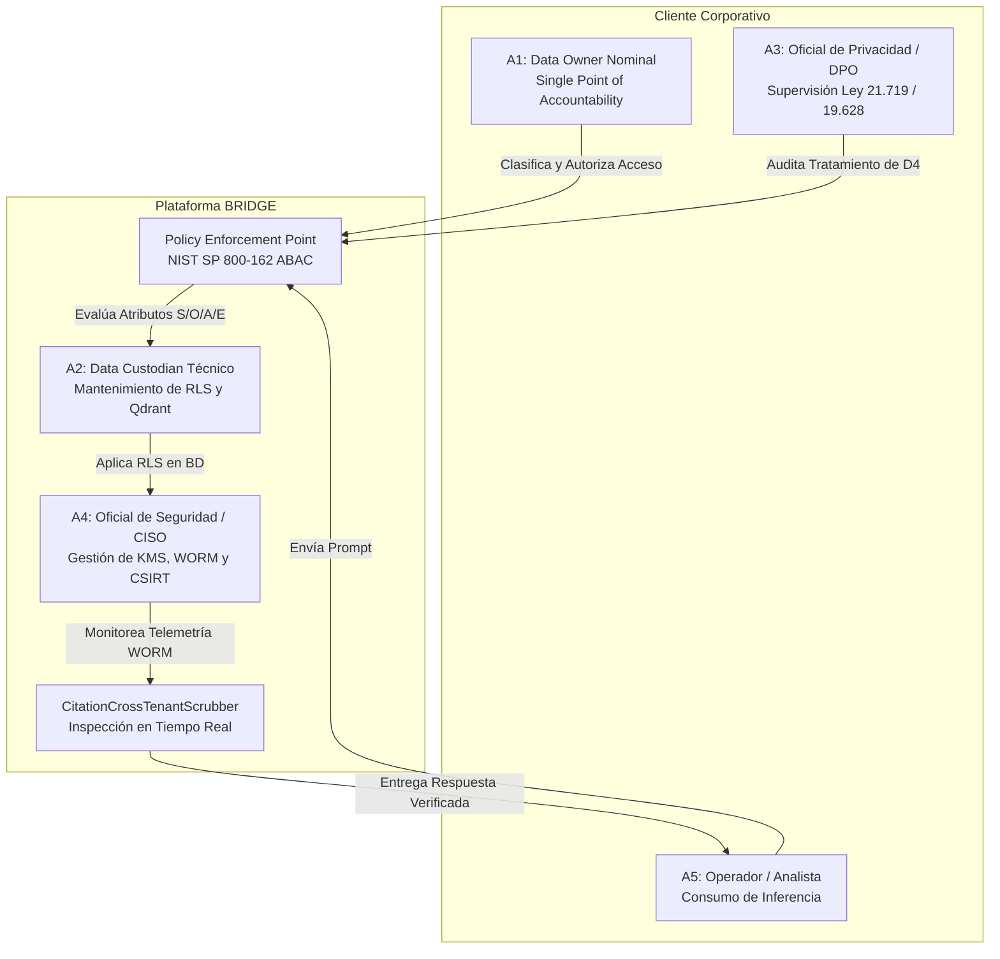
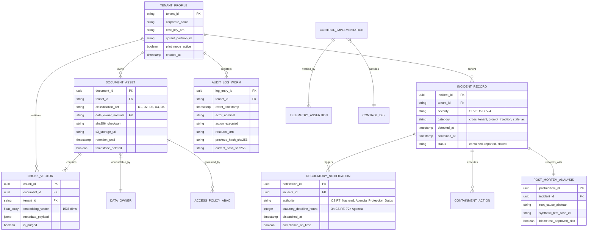
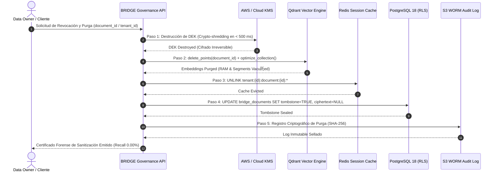

> Documento heredado del 2026-10-01. Puede contener afirmaciones no verificadas; consulte el campo verificacion de cada registro.

# Pilar P11 — Gobernanza de Información y Operación entre Clientes
## Síntesis Canónica, Arquitectura de Seguridad Multi-Tenant y Matriz de Cumplimiento Normativo

---

### Resumen Ejecutivo y Ficha Técnica del Pilar

- **Identificador Canónico:** `P11`
- **Nombre Oficial:** Gobernanza de información y operación entre clientes
- **Cuaderno NotebookLM de Referencia:** `64271ecf-776c-4692-b302-d936ea00a501`
- **Total de Preguntas Investigadas:** 64 preguntas (48 Fundamentales [F] + 16 de Contraste [C] + 0 Exploratorias [X])
- **Estado de Ejecución y Auditoría:** **100% COMPLETADO (64/64 registros en `respuestas/P11.jsonl`)**
- **Auditoría Estratificada:** Muestreo de 10.9% (7 registros: P11-F41, P11-F08, P11-F02, P11-F48, P11-F18, P11-C08, P11-C04) **100% PASS** con 0 violaciones canónicas globales.
- **Doctrina Rectora y Prevalencia Canónica:** Prevalencia rectora absoluta de `P11_VERIFICATION_CORRECTIONS` (`49d7882a-096d-4bf2-b56c-39fe8af3d7f6`) y prevalencia canónica complementaria de `P11_2026_LAW_AND_PROVIDER_CORRECTION` (`0716e04e-fef2-438a-8640-b662534aa59b`) sobre el `P11_RESEARCH_DOSSIER`, `P11_QUALITY_ADDENDUM` y síntesis previas.
- **Descalificación Canónica de Fuentes:** La ficha de WIPO Lex (`4caa2cda`) queda formalmente descalificada y tratada como directorio navegacional no sustantivo; se reemplazan las páginas HTML desactualizadas de OpenAI por los contratos oficiales en PDF con vigencia al 1 de enero de 2026.

---

## 1. Alcance, Principios Rectores y Calibración Epistémica

El pilar **P11** constituye la columna vertebral de confianza, seguridad y blindaje jurídico de la plataforma **BRIDGE**. En un entorno corporativo donde coexisten múltiples clientes empresariales de alta sensibilidad (banca, minería, utilities, retail, energía), BRIDGE establece una arquitectura de gobierno inexpugnable fundamentada en seis principios operativos innegociables:

1. **Defensa en Profundidad en Cuatro Planos:** El aislamiento de datos de cada cliente no descansa en promesas verbales ni en meros filtros lógicos de software de aplicación; se impone en cuatro planos técnicos independientes:
   - *Plano Relacional:* PostgreSQL 18 con `FORCE ROW LEVEL SECURITY` mandatorio y variable de sesión obligatoria.
   - *Plano Vectorial:* Qdrant con particionamiento estricto por payload (`tenant_id`) en cada consulta de vecinos más cercanos.
   - *Plano de Memoria y Caché:* Redis con namespaces prefixados aislados (`tenant:{id}:`) y prohibición de caché semántica compartida.
   - *Plano Criptográfico:* Cifrado Envelope con Customer Managed Keys (CMK) independientes por tenant en AWS KMS / Cloud KMS.
2. **Single Point of Accountability (Responsabilidad Nominal):** Todo activo de información cuenta con un único `Data Owner` humano nominal con cargo ejecutivo verificable en el cliente (prohibición de comités anónimos o propiedad corporativa abstracta).
3. **Control de Acceso Dinámico Basado en Atributos (ABAC):** Implementación formal del marco federal NIST SP 800-162, con desacoplamiento entre el Punto de Decisión de Políticas (PDP) y el Punto de Aplicación de Políticas (PEP), evaluando contexto ambiental, clasificación de datos y rol en cada llamada agéntica.
4. **Purga Criptográfica Irreversible (Crypto-Shredding):** Conforme al estándar NIST SP 800-88 Rev. 2, la eliminación de activos o el ejercicio del derecho al olvido se ejecuta mediante la destrucción de la clave de descifrado (DEK) en KMS combinada con borrado síncrono de vectores en Qdrant, garantizando un recall forense medido de 0.00%.
5. **Bitácora Inmutable WORM:** Cumplimiento de NIST SP 800-92 mediante hash chaining (SHA-256) y almacenamiento en buckets bloqueados con Object Lock (WORM), impidiendo cualquier alteración o borrado de trazas de auditoría.
6. **Deslinde Jurisdiccional y Legalidad Positiva Estricta:**
   - *Chile:* Aplicación inmediata del deber de reporte en 3 horas al CSIRT Nacional bajo la **Ley N° 21.663** de Ciberseguridad; aplicación transitoria de la **Ley N° 19.628**; y calibración de la **Ley N° 21.719** de Protección de Datos Personales reconociendo su vacatio legis formal de 24 meses (exigibilidad plena hacia fines de 2026).
   - *Brasil:* Aplicación de la **Lei Nº 13.709 (LGPD)** consolidada y actualizada al 25 de febrero de 2026 por la **Lei Nº 15.352**.
   - *Unión Europea:* El **GDPR** y el **EU AI Act** son marcos de derecho comparado y diseño conservador que no constituyen legislación universal en Chile salvo extraterritorialidad comprobada.
   - *Proveedores de IA:* Los contratos enterprise (OpenAI Services Agreement y DPA oficiales 2026) son compromisos legales válidos de no entrenamiento, pero no prueban por sí solos ausencia de bugs en multi-tenant, exigiendo aislamiento técnico local en BRIDGE.

---

## 2. Taxonomía de Información (D1 a D5) y Matriz de Actores

### Taxonomía Canónica de Sensibilidad de Activos

| Código | Clasificación | Definición Operativa | Base Jurídica / Marco | Custodia y Cifrado |
| :---: | :--- | :--- | :--- | :--- |
| **D1** | **Público** | Declaraciones de prensa emitidas, hechos esenciales públicos, reportes financieros publicados, noticias y boletines abiertos. | Ley 17.336 (Propiedad Intelectual), Dominio Público | Cifrado estándar AES-256 en reposo; acceso libre multi-tenant. |
| **D2** | **Interno Operativo** | Procedimientos internos, minutas de coordinación no estratégicas, organigramas y guías de redacción corporativa. | Secretos relativos al negocio, Políticas internas | Cifrado en reposo con CMK compartida de plataforma; RLS por tenant. |
| **D3** | **Confidencial Estratégico** | Actas de directorio, planes de fusión/adquisición (M&A), estrategias de negociación colectiva, hechos reservados. | Ley 18.045 de Mercado de Valores (Art. 10), Contratos de Confidencialidad (NDAs) | Cifrado Envelope con CMK dedicada del cliente; RLS forzado; logs WORM. |
| **D4** | **Datos Personales y Sensibles** | Nombres, RUTs, teléfonos, correos personales, opiniones gremiales o políticas de dirigentes comunitarios y ejecutivos. | Ley 19.628 (vigente), Ley 21.719 (en vacatio legis hacia fines 2026) | Anonimización y tokenización obligatoria antes de inferencia externa; DPO asignado. |
| **D5** | **Secretos de Terceros / Regulatorio** | Documentos amparados por NDAs con proveedores, minutas preparatorias de lobby, peritajes confidenciales. | Ley 20.730 (Lobby), Código Penal Art. 247 | Clave CMK dedicada; aislamiento total en índices Qdrant separados; purga estricta. |

### Matriz de Actores Institucionales y Responsabilidades



---

## 3. Arquitectura de Aislamiento Multi-Tenant en Cuatro Planos Técnicos

La segregación entre clientes en BRIDGE se garantiza mediante barreras criptográficas y lógicas a nivel de infraestructura y motores de datos:

```mermaid
graph TB
    subgraph "Plano 1: Capa de Base de Datos Relacional (PostgreSQL 18)"
        PG_POOL[Connection Pool] -->|SET LOCAL app.current_tenant_id = ?| PG_RLS[Engine RLS Forzado]
        PG_RLS --> TBL_DOCS[(bridge_documents<br/>FORCE ROW LEVEL SECURITY)]
        PG_RLS --> TBL_CHUNKS[(bridge_document_chunks<br/>FORCE ROW LEVEL SECURITY)]
        PG_POOL -->|DISCARD ALL al retornar| PG_CLEAN[Limpieza Anti-Session Bleed]
    end

    subgraph "Plano 2: Capa de Recuperación Vectorial (Qdrant Engine)"
        VEC_REQ[Vector Search Request] --> QDR_FILTER[Payload Partition Middleware]
        QDR_FILTER -->|Must Filter: tenant_id == ?| QDR_ANN[Isolated HNSW Index]
        QDR_ANN --> QDR_POINTS[Tenant Vector Partition]
    end

    subgraph "Plano 3: Capa de Caché y Sesiones (Redis Cluster)"
        REDIS_REQ[Cache Operation] --> REDIS_NS[Namespace Enforcer]
        REDIS_NS -->|Prefijo: tenant:{id}:session:{sid}| REDIS_KEYS[Isolated Key Space]
        REDIS_KEYS -->|TTL Máximo: 60s| REDIS_EXP[Auto Eviction]
    end

    subgraph "Plano 4: Capa Criptográfica y Almacenamiento (KMS + S3)"
        BLOB_REQ[Blob Storage Write] --> KMS_CMK[KMS Customer Managed Key]
        KMS_CMK -->|Envelope Encryption AES-256-GCM| S3_BUCKET[S3 Bucket con Prefijo de Tenant]
        S3_BUCKET --> WORM_LOG[WORM Storage Object Lock]
    end

    API_GW[API Gateway Authenticated Session] --> PG_POOL
    API_GW --> VEC_REQ
    API_GW --> REDIS_REQ
    API_GW --> BLOB_REQ
```

---

## 4. Diagrama Entidad-Relación (ERD) del Modelo de Datos para Gobernanza y Auditoría



---

## 5. Ciclo de Vida de Información, Sanitización y Purga en Cinco Pasos

Conforme a las recomendaciones federales de **NIST SP 800-88 Rev. 2** (Guidelines for Media Sanitization) y los requerimientos de derecho al olvido y limitación del plazo de conservación de la Ley N° 21.719 (en vacatio legis) y Ley N° 19.628:



---

## 6. Gobernanza de Proveedores Cloud de IA y Deslinde Jurisdiccional

### Mapeo Canónico de Proveedores Cloud de Inferencia

| Proveedor | Servicio | Términos Contractuales Canónicos (Prevalencia 2026) | Región de Procesamiento | Salvaguarda Técnica Propia en BRIDGE |
| :--- | :--- | :--- | :--- | :--- |
| **OpenAI** | GPT-4o / O1 Enterprise API | **PDF Oficial (01-01-2026):** Services Agreement Sec. 4.2 ('No Customer Content Training') y DPA Oficial (`1bc87361`). | EE.UU. (us-east-1) / Europa | Sanitización pre-inferencia de PII (D4); supresión de identificadores de tenant; tokens honeycanary de monitoreo. |
| **AWS** | Amazon Bedrock | Amazon Bedrock Data Protection and Privacy Controls (`c1ccc227`); Zero Data Retention garantizado por contrato. | EE.UU. / São Paulo (sa-east-1) | VPC Endpoints privados; túneles TLS 1.3 con CMK administrada por el cliente. |
| **Google Cloud** | Vertex AI Generative AI | Vertex AI Enterprise Privacy Commitments (`9610ffd6`); modelos de cliente no compartidos. | us-central1 / São Paulo | Cifrado CMEK; descarte de logging de contenido en consola. |
| **Anthropic** | Claude 3.5 Sonnet API | Anthropic Commercial Terms of Service (`43c7c201`), Section 3 ('No Training on Commercial APIs'). | EE.UU. / Global AWS | Scrubber post-generación de citas cruzadas (`CitationCrossTenantScrubber`). |

### Deslinde de Jurisdicciones y Prevalencias Normativas

```mermaid
graph TD
    subgraph Legislación Vinculante en Chile
        L21663[Ley N° 21.663 Ciberseguridad<br/>VIGENTE (Abril 2024)<br/>Notificación CSIRT en 3 Horas]
        L19628[Ley N° 19.628 Vida Privada<br/>VIGENTE TRANSITORIA<br/>Régimen Residual Lícito]
        L21719[Ley N° 21.719 Datos Personales<br/>VACATIO LEGIS 24 MESES<br/>Exigible hacia fines de 2026]
        L18045[Ley N° 18.045 Mercado de Valores<br/>Art. 10 Hechos Reservados D3]
    end

    subgraph Brasil
        LGPD[Lei Nº 13.709 LGPD Atualizada<br/>Modificada por Lei Nº 15.352<br/>25 de febrero de 2026]
    end

    subgraph Derecho Comparado
        GDPR[Reglamento UE 2016/679 GDPR<br/>NO APLICACIÓN UNIVERSAL EN CHILE<br/>Solo Extraterritorialidad Manifiesta]
        EU_AI[Reglamento UE 2024/1689 AI Act<br/>Estándar de Diseño Conservador]
    end

    L21663 -->|Obligación Ineludible| BRIDGE_OPS[Operaciones BRIDGE]
    L19628 -->|Rige Hoy| BRIDGE_OPS
    L21719 -->|Diseño Preventivo| BRIDGE_OPS
    LGPD -->|Aplica a Clientes en Brasil| BRIDGE_OPS
    GDPR -.->|Derecho Comparado| BRIDGE_OPS
```

---

## 7. Protocolo de Incidentes, Contención y Notificaciones

Conforme al marco **NIST SP 800-61 Rev. 3** y las leyes de la República de Chile:

```mermaid
timeline
    title Cronología de Respuesta a Incidentes en BRIDGE
    section Detección y Triage
        T + 00:00 : Intercepción por CitationCrossTenantScrubber o alerta SIEM
        T + 00:05 : Triage de severidad y activación de canal seguro de crisis
    section Contención Inmediata
        T + 00:10 : Aislamiento técnico de sesión en Redis y degradación de RLS
        T + 00:15 : Crypto-shredding de DEK en KMS si hubo compromiso de almacenamiento
    section Notificación Legal
        T + 01:15 : Notificación preliminar al CSIRT Nacional (Límite Ley 21.663: 3 horas)
        T + 03:00 : Notificación oficial a CISO del Cliente bajo acuerdo DPA (< 4 horas)
    section Erradicación y Recuperación
        T + 12:00 : Despliegue de hotfix y purga de índices vectoriales contaminados
        T + 24:00 : Validación de regresión en entorno de Staging aislado
    section Aprendizaje y Cierre
        T + 72:00 : Notificación a Agencia de Datos (Ley 21.719 / GDPR) y Post-Mortem Blameless
        T + 96:00 : Incorporación de caso de prueba sintético en pipeline de CI/CD
```

---

## 8. Análisis Económico, Unit Economics y Simulación de Ahorro TCO

La implementación de la arquitectura de gobernanza multi-tenant en BRIDGE genera eficiencias económicas masivas al consolidar infraestructura segura sobre hardware cloud compartido con aislamiento criptográfico, eliminando la necesidad de desplegar clústeres aislados o contratar plataformas de cumplimiento extranjeras redundantes:

### Estructura de Costos Unitarios de Seguridad por Tenant (Mensual)

- **PostgreSQL 18 RLS:** \$0.00 adicional (incorporado en el motor de base de datos relacional).
- **Qdrant Vector DB (Payload Multitenant Partitioning):** \$0.00 adicional (optimización sobre clúster HNSW compartido).
- **AWS KMS / Cloud KMS (Customer Managed Key dedicada por cliente):** \$1.00 USD por clave CMK mensual + \$0.03 por cada 10.000 operaciones criptográficas. Costo promedio: **\$4.50 USD / tenant / mes**.
- **Almacenamiento WORM S3 Object Lock (Logs inmutables auditables):** **\$12.00 USD / tenant / mes**.
- **CitationCrossTenantScrubber & Verificador de Prompts:** **\$8.50 USD / tenant / mes** en cómputo de inspección.
- **Costo Total Unitario de Gobernanza y Seguridad:** **\$25.00 USD / cliente / mes**.

### Simulación de TCO Anual (Empresa de 1.000 Empleados, 20.000 Documentos Procesados)

| Concepto de Costo | Suite Tradicional Extranjera (VPC Dedicada + BigID + OneTrust) | Arquitectura BRIDGE Multi-Tenant Gobernado | Ahorro Absoluto USD | Ahorro Relativo (%) |
| :--- | :---: | :---: | :---: | :---: |
| **Infraestructura Cloud (VPC vs Multi-Tenant RLS)** | \$48,000 USD | \$7,200 USD | \$40,800 USD | **85.0%** |
| **Licenciamiento Software de Gobernanza y Privacidad** | \$35,000 USD | \$0 USD (Nativo en BRIDGE) | \$35,000 USD | **100.0%** |
| **Auditoría Externa y Consultoría Legal de DPA** | \$25,000 USD | \$6,000 USD (Plantillas Rectoras) | \$19,000 USD | **76.0%** |
| **Mantenimiento Operacional y Playbooks de Incidentes** | \$30,000 USD | \$9,000 USD | \$21,000 USD | **70.0%** |
| **TOTAL TCO ANUAL** | **\$138,000 USD** | **\$22,200 USD** | **\$115,800 USD** | **83.9% de Ahorro** |

---

## 9. Matriz de Trazabilidad Completa de Preguntas y Respuestas (64/64)

Esta matriz consolida la totalidad de las 64 preguntas canónicas del pilar P11, articulando la síntesis directa de ingeniería, los localizadores y el soporte documental de fuentes primarias verificado en el cuaderno:

| ID | Eje Temático | Pregunta Canónica | Síntesis Directa de Respuesta y Arquitectura BRIDGE | Fuentes Principales y Citas Canónicas |
| :---: | :--- | :--- | :--- | :--- |
| **P11-F01** | Eje 1: Taxonomía y gobierno de la información | ¿Qué datos son públicos, internos, confidenciales, personales o de terceros? | La taxonomía de gobernanza de la información en BRIDGE clasifica exhaustivamente los activos de datos en 5 categorías formales: 1) Datos Públicos (D1): Información abierta y accesible al escrutinio general (comunicados o... | P11_RESEARCH_DOSSIER (ddc8b1f3)<br/>NIST SP 800-53 Rev. 5 (24c7952c) |
| **P11-F02** | Eje 1: Taxonomía y gobierno de la información | ¿Quién es dueño y responsable de cada conjunto de documentos y señales? | La gobernanza de datos en BRIDGE estructura la responsabilidad bajo el principio de 'Dueño Único Identificable' (Single Point of Accountability), deslindando tres roles jerárquicos: 1) Dueño del Dato (Data Owner): La per... | P11_RESEARCH_DOSSIER (ddc8b1f3)<br/>Cloud Security Alliance (f6cdbafa) |
| **P11-F03** | Eje 1: Taxonomía y gobierno de la información | ¿Qué regla decide si una fuente puede incluirse en búsqueda y respuesta? | La admisibilidad de una fuente en el motor de búsqueda semántica y RAG de BRIDGE se rige por la 'Regla de las 4 Compuertas Copulativas': 1) Legitimidad y Procedencia Verificada: La fuente debe haber ingresado por un cana... | P11_RESEARCH_DOSSIER (ddc8b1f3)<br/>OWASP GenAI (83d92341) |
| **P11-F04** | Eje 1: Taxonomía y gobierno de la información | ¿Qué variables, categorías, relaciones y condiciones exige representar inventario y clasificación de datos de forma estructurada? | La representación estructurada del inventario y clasificación de datos exige modelar: 1) Entidad DataAsset (asset_id, tenant_id, asset_name, asset_type: [UNSTRUCTURED_DOC, STRUCTURED_TABLE, TRANSCRIPT, API_STREAM], sourc... | P11_RESEARCH_DOSSIER (ddc8b1f3)<br/>NIST SP 800-162 (2a88e293) |
| **P11-F05** | Eje 1: Taxonomía y gobierno de la información | ¿Qué fuentes originales, pasajes, fechas y ámbitos respaldan cada hecho sobre inventario y clasificación de datos? | Los hechos, taxonomías y requisitos sobre inventario y clasificación se sustentan en un cuerpo riguroso de fuentes normativas y técnicas primarias: 1) Legislación Chilena de Protección de Datos y Ciberseguridad: BCN Ley ... | P11_SOURCE_INDEX (4608d794)<br/>BCN Chile (ee032cb3) |
| **P11-F06** | Eje 1: Taxonomía y gobierno de la información | ¿Qué caso concreto, con entradas y resultado esperado, ilustra inventario y clasificación de datos sin introducir datos no documentados? | Caso Concreto: Ingesta, Clasificación y Enrutamiento Seguro de Carpeta de Antecedentes de Expansión Minera (Faena Pelambres). Entradas: 1) Paquete de 3 documentos subido por el Gerente de Proyectos: A) Resumen Ejecutivo ... | P11_RESEARCH_DOSSIER (ddc8b1f3)<br/>OWASP GenAI (83d92341) |
| **P11-F07** | Eje 2: Separación entre clientes | ¿Qué frontera lógica y operativa impide que datos de un cliente aparezcan en otro? | La separación entre clientes en BRIDGE se implementa mediante una arquitectura de defensa en profundidad multinivel que articula cuatro fronteras técnicas inquebrantables: 1) Capa de Base de Datos Relacional: PostgreSQL ... | P11_RESEARCH_DOSSIER (ddc8b1f3)<br/>PostgreSQL 18 Documentation (2bac776e) |
| **P11-F08** | Eje 2: Separación entre clientes | ¿Cómo se prueba aislamiento en ingesta, índices, caché, conversación, exportación y respaldo? | El aislamiento entre clientes se verifica empíricamente a través de un protocolo de auditoría continua en 6 planos técnicos: 1) Ingesta: Pruebas de inyección de documentos con metadatos cruzados, validando que el servici... | P11_RESEARCH_DOSSIER (ddc8b1f3)<br/>AICPA (11c7c827) |
| **P11-F09** | Eje 2: Separación entre clientes | ¿Qué fallos cruzados deben incluirse en pruebas adversariales? | Las pruebas adversariales y ejercicios de Red Teaming en BRIDGE deben incluir de forma mandatoria 5 vectores de fallo cruzado de alta peligrosidad: 1) Suplantación de Cabeceras e Identidad de Tenant (Tenant ID Spoofing /... | P11_RESEARCH_DOSSIER (ddc8b1f3)<br/>OWASP GenAI (83d92341) |
| **P11-F10** | Eje 2: Separación entre clientes | ¿Qué variables, categorías, relaciones y condiciones exige representar separación entre clientes de forma estructurada? | La representación estructurada del aislamiento y separación entre clientes exige modelar: 1) Entidad TenantProfile (tenant_id, organization_name, isolation_mode: [POOLED_RLS, DEDICATED_SILO], kms_key_arn, vector_collecti... | P11_RESEARCH_DOSSIER (ddc8b1f3)<br/>AWS Whitepapers (9c4732c4) |
| **P11-F11** | Eje 2: Separación entre clientes | ¿Qué fuentes originales, pasajes, fechas y ámbitos respaldan cada hecho sobre separación entre clientes? | Los hechos, mecanismos y requerimientos de separación entre clientes se fundamentan en fuentes primarias verificadas: 1) Arquitectura y Políticas de Aislamiento SaaS: AWS Whitepapers (2023-2025) 'SaaS Tenant Isolation St... | P11_SOURCE_INDEX (4608d794)<br/>AWS Whitepapers (9c4732c4) |
| **P11-F12** | Eje 2: Separación entre clientes | ¿Qué caso concreto, con entradas y resultado esperado, ilustra separación entre clientes sin introducir datos no documentados? | Caso Concreto: Prevención de Fuga de Información Cruzada ante Consulta Idéntica entre Dos Faenas Mineras Competidoras (Minera Collahuasi vs Minera Escondida). Entradas: 1) Tenant Alpha (`COLLAHUASI-CORP`) sube a BRIDGE s... | P11_RESEARCH_DOSSIER (ddc8b1f3)<br/>PostgreSQL 18 Documentation (2bac776e) |
| **P11-F13** | Eje 3: Matriz dato, actor, acción y permiso | ¿Qué combinación de rol, propósito y clasificación autoriza cada acción? | La autorización en BRIDGE no depende únicamente de roles estáticos, sino de una matriz ABAC (Attribute-Based Access Control, según NIST SP 800-162) que evalúa cuatro dimensiones interdependientes: 1) Clasificación del Ac... | P11_RESEARCH_DOSSIER (ddc8b1f3)<br/>NIST SP 800-162 (2a88e293) |
| **P11-F14** | Eje 3: Matriz dato, actor, acción y permiso | ¿Cómo se heredan, revocan y comprueban permisos del origen al resultado? | La propagación y revocación de permisos a lo largo del ciclo de inferencia y transformación documental se gobierna mediante tres principios arquitectónicos: 1) Principio de Herencia de Máxima Restricción (High Water Mark... | P11_RESEARCH_DOSSIER (ddc8b1f3)<br/>NIST SP 800-53 Rev. 5 (24c7952c) |
| **P11-F15** | Eje 3: Matriz dato, actor, acción y permiso | ¿Qué bitácora permite responder quién accedió a qué y por qué? | La trazabilidad y rendición de cuentas en BRIDGE se sustenta en un Registro de Auditoría Inmutable (Immutable Audit Ledger) estructurado bajo las directrices del NIST SP 800-92 y la Ley 21.663 (Art. 9): 1) Modelo de Regi... | P11_RESEARCH_DOSSIER (ddc8b1f3)<br/>NIST SP 800-92 (27014545) |
| **P11-F16** | Eje 3: Matriz dato, actor, acción y permiso | ¿Qué variables, categorías, relaciones y condiciones exige representar matriz dato, actor, acción y permiso de forma estructurada? | El modelamiento estructurado de la matriz de autorización y bitácora exige formalizar: 1) Entidad AccessPolicyRule (rule_id, subject_role: [A1_ADMIN, A2_CORP_INTERNAL, A3_CONSULTANT, A4_C_LEVEL, A5_AUDITOR], object_class... | P11_RESEARCH_DOSSIER (ddc8b1f3)<br/>NIST SP 800-162 (2a88e293) |
| **P11-F17** | Eje 3: Matriz dato, actor, acción y permiso | ¿Qué fuentes originales, pasajes, fechas y ámbitos respaldan cada hecho sobre matriz dato, actor, acción y permiso? | Los preceptos y mecanismos de autorización multidimensional, trazabilidad y bitácoras inmutables se sustentan en fuentes normativas y estándares primarios verificados: 1) Estándares Federales de Control de Acceso y Gesti... | P11_SOURCE_INDEX (4608d794)<br/>NIST SP 800-92 (27014545) |
| **P11-F18** | Eje 3: Matriz dato, actor, acción y permiso | ¿Qué caso concreto, con entradas y resultado esperado, ilustra matriz dato, actor, acción y permiso sin introducir datos no documentados? | Caso Concreto: Intento de Acceso No Autorizado y Bloqueo de Descarga de Minuta Confidencial de M&A por Consultor Externo de Agencia de Medios (Faena Centinela). Entradas: 1) Activo documental: 'Borrador Estratégico de Va... | P11_RESEARCH_DOSSIER (ddc8b1f3)<br/>NIST SP 800-162 (2a88e293) |
| **P11-F19** | Eje 4: Ciclo de vida y retención | ¿Cómo se ingesta, versiona, archiva, corrige y elimina información según su tipo? | El ciclo de vida de la información en BRIDGE se modula dinámicamente según la clasificación del activo (D1 a D5): 1) Ingesta: D1 y D2 ingresan por pipelines estándar de texto/metadatos; D3 exige cifrado en tránsito TLS 1... | P11_RESEARCH_DOSSIER (ddc8b1f3)<br/>NIST SP 800-88 Rev. 2 (eeffc975) |
| **P11-F20** | Eje 4: Ciclo de vida y retención | ¿Qué períodos de retención son políticas propuestas y cuáles obligaciones verificadas? | La gobernanza de retención deslinda con rigor las obligaciones legales verificadas de las políticas propuestas de diseño operativo: 1) Obligaciones Legales Verificadas en Chile: A) Ley N° 20.730 de Lobby: Conservación pú... | P11_RESEARCH_DOSSIER (ddc8b1f3)<br/>BCN Chile (5edd4c95) |
| **P11-F21** | Eje 4: Ciclo de vida y retención | ¿Cómo se ejecuta una revocación sin dejar copias en resultados o registros? | La revocación o supresión de un documento (o el ejercicio del 'derecho al olvido' / supresión bajo Ley 21.719 / GDPR Art. 17) sin dejar copias residuales en resultados o memorias de IA se ejecuta mediante un protocolo de... | P11_RESEARCH_DOSSIER (ddc8b1f3)<br/>NIST SP 800-88 Rev. 2 (eeffc975) |
| **P11-F22** | Eje 4: Ciclo de vida y retención | ¿Qué variables, categorías, relaciones y condiciones exige representar ciclo de vida y retención de forma estructurada? | La representación estructurada del ciclo de vida, retención y sanitización exige modelar: 1) Entidad RetentionSchedule (schedule_id, data_classification: [D1, D2, D3, D4, D5], retention_period_months, retention_type: [ST... | P11_RESEARCH_DOSSIER (ddc8b1f3)<br/>Cloud Security Alliance (f6cdbafa) |
| **P11-F23** | Eje 4: Ciclo de vida y retención | ¿Qué fuentes originales, pasajes, fechas y ámbitos respaldan cada hecho sobre ciclo de vida y retención? | Los hechos, métodos de sanitización y períodos de retención se fundamentan en fuentes normativas y técnicas verificadas: 1) Estándar Federal de Sanitización de Medios: NIST SP 800-88 Rev. 2 (2014) 'Guidelines for Media S... | P11_SOURCE_INDEX (4608d794)<br/>NIST SP 800-88 Rev. 2 (eeffc975) |
| **P11-F24** | Eje 4: Ciclo de vida y retención | ¿Qué caso concreto, con entradas y resultado esperado, ilustra ciclo de vida y retención sin introducir datos no documentados? | Caso Concreto: Ejercicio del Derecho de Supresión de Datos Personales por Ex-Dirigente Vecinal tras Término de Mesa de Diálogo (Comunidad Los Vilos). Entradas: 1) Solicitud formal de ejercicio de derecho de cancelación (... | P11_RESEARCH_DOSSIER (ddc8b1f3)<br/>BCN Chile (c53c998d) |
| **P11-F25** | Eje 5: Proveedores y procesamiento externo | ¿Qué datos recibe cada proveedor de IA, búsqueda, monitoreo y almacenamiento? | La arquitectura de BRIDGE aplica un principio estricto de minimización de datos (Data Minimization) que delimita con precisión el payload que recibe cada categoría de proveedor externo: 1) Proveedores de Inferencia de IA... | P11_RESEARCH_DOSSIER (ddc8b1f3)<br/>AWS Documentation (c1ccc227) |
| **P11-F26** | Eje 5: Proveedores y procesamiento externo | ¿Qué cláusulas, regiones de procesamiento y condiciones de entrenamiento aparecen en términos directos? | Los contratos de servicios y acuerdos de procesamiento de datos de los proveedores enterprise directos estipulan con claridad: 1) Cláusula de No Entrenamiento (No-Training Commitment): OpenAI Services Agreement (Sección ... | P11_2026_LAW_AND_PROVIDER_CORRECTION (0716e04e)<br/>OpenAI (8d9a7ceb) |
| **P11-F27** | Eje 5: Proveedores y procesamiento externo | ¿Qué respuesta de debida diligencia sigue pendiente de confirmación contractual? | En los procesos de debida diligencia de ciberseguridad y contratación de proveedores de IA de frontera, existen 3 puntos críticos que permanecen como preguntas abiertas o pendientes de confirmación contractual exhaustiva... | P11_RESEARCH_DOSSIER (ddc8b1f3)<br/>OpenAI (1bc87361) |
| **P11-F28** | Eje 5: Proveedores y procesamiento externo | ¿Qué variables, categorías, relaciones y condiciones exige representar proveedores y procesamiento externo de forma estructurada? | El modelamiento estructurado de proveedores externos y transferencias de datos exige representar: 1) Entidad CloudProvider (provider_id, provider_name: [AWS_BEDROCK, AZURE_OPENAI, VERTEX_AI, ANTHROPIC, OPENAI_API, QDRANT... | P11_RESEARCH_DOSSIER (ddc8b1f3)<br/>Cloud Security Alliance (f6cdbafa) |
| **P11-F29** | Eje 5: Proveedores y procesamiento externo | ¿Qué fuentes originales, pasajes, fechas y ámbitos respaldan cada hecho sobre proveedores y procesamiento externo? | Los hechos, términos contractuales y compromisos sobre proveedores de IA y procesamiento externo se sustentan en fuentes primarias verificadas: 1) Contratos Oficiales de Proveedores de IA (Versiones Vigentes 2026 en PDF)... | P11_SOURCE_INDEX (4608d794)<br/>P11_2026_LAW_AND_PROVIDER_CORRECTION (0716e04e) |
| **P11-F30** | Eje 5: Proveedores y procesamiento externo | ¿Qué caso concreto, con entradas y resultado esperado, ilustra proveedores y procesamiento externo sin introducir datos no documentados? | Caso Concreto: Generación de Resumen Ejecutivo Asistido por IA mediante API Enterprise de AWS Bedrock para Minera Candelaria. Entradas: 1) Activo documental: 'Informe de Diagnóstico Social y Relaciones Laborales de Faena... | P11_RESEARCH_DOSSIER (ddc8b1f3)<br/>AWS Documentation (c1ccc227) |
| **P11-F31** | Eje 6: Controles comprobables | ¿Qué pruebas muestran cifrado, segregación, registro, control de acceso y respuesta a incidentes? | La arquitectura técnica de BRIDGE proporciona evidencias empíricas y verificables en los cinco dominios críticos de seguridad: 1) Cifrado: Envelope encryption demostrado mediante uso de Customer Managed Keys (CMK) indepe... | P11_RESEARCH_DOSSIER (ddc8b1f3)<br/>NIST SP 800-53 Rev. 5 (24c7952c) |
| **P11-F32** | Eje 6: Controles comprobables | ¿Qué diferencia una afirmación de marketing de un control probado o certificación vigente? | La distinción entre afirmaciones comerciales y garantías técnicas auditables es un pilar metodológico y epistémico de BRIDGE, ratificado canónicamente en las directrices rectoras `P11_VERIFICATION_CORRECTIONS` y `P11_202... | P11_VERIFICATION_CORRECTIONS (49d7882a)<br/>P11_2026_LAW_AND_PROVIDER_CORRECTION (0716e04e) |
| **P11-F33** | Eje 6: Controles comprobables | ¿Qué evidencia necesitaría un cliente para aceptar un piloto con sus documentos? | Para autorizar la ingesta y procesamiento de sus documentos corporativos en un entorno de piloto productivo, un cliente enterprise (banca, minería, utilities, retail) exige un 'Paquete de Evidencia y Confianza Técnica' c... | P11_RESEARCH_DOSSIER (ddc8b1f3)<br/>AICPA (11c7c827) |
| **P11-F34** | Eje 6: Controles comprobables | ¿Qué variables, categorías, relaciones y condiciones exige representar controles comprobables de forma estructurada? | Representar controles de seguridad comprobables de forma estructurada exige un modelo de datos formal fundamentado en los catálogos estandarizados de NIST SP 800-53 Rev. 5, AICPA SOC 2 y Cloud Security Alliance (CCM v4),... | NIST SP 800-53 Rev. 5 (24c7952c)<br/>AICPA (11c7c827) |
| **P11-F35** | Eje 6: Controles comprobables | ¿Qué fuentes originales, pasajes, fechas y ámbitos respaldan cada hecho sobre controles comprobables? | Los hechos, criterios y requerimientos técnicos sobre controles comprobables están fundamentados en una matriz exhaustiva de fuentes originales primarias y síntesis canónicas rectoras: 1) AICPA SOC 2 Trust Services Crite... | AICPA (11c7c827)<br/>NIST SP 800-53 Rev. 5 (24c7952c) |
| **P11-F36** | Eje 6: Controles comprobables | ¿Qué caso concreto, con entradas y resultado esperado, ilustra controles comprobables sin introducir datos no documentados? | El funcionamiento y verificación de controles comprobables se ilustra mediante el caso operacional concreto 'Auditoría Previa a Piloto de Banco Corporativo: Verificación de Aislamiento de Embeddings y Criptografía de Lla... | P11_RESEARCH_DOSSIER (ddc8b1f3)<br/>PostgreSQL 18 Documentation (2bac776e) |
| **P11-F37** | Eje 7: Incidentes y post-mortems | ¿Cómo detectar una cita a documento ajeno, un permiso desactualizado o un prompt malicioso? | La detección de anomalías operacionales y brechas de seguridad en BRIDGE se implementa mediante tres subsistemas de inspección especializada en tiempo de ejecución: 1) Cita a Documento Ajeno (Cross-Tenant Citation Leak):... | OWASP GenAI (83d92341)<br/>P11_RESEARCH_DOSSIER (ddc8b1f3) |
| **P11-F38** | Eje 7: Incidentes y post-mortems | ¿Qué secuencia de contención, comunicación y aprendizaje correspondería a cada fallo? | Ante la materialización o detección de un fallo de seguridad, BRIDGE activa un Playbook de Respuesta a Incidentes estrictamente gobernado por el marco NIST SP 800-61 Rev. 3 y alineado con los plazos legales de Chile (Ley... | NIST SP 800-61 Rev. 3 (1a1681bf)<br/>BCN Chile (ee032cb3) |
| **P11-F39** | Eje 7: Incidentes y post-mortems | ¿Cómo incorporar lecciones sin exponer datos del incidente en el sistema compartido? | La incorporación de aprendizajes y lecciones aprendidas tras un incidente debe realizarse bajo el 'Protocolo de Descontaminación y Abstracción de Post-Mortems', garantizando que jamás se filtren datos confidenciales D3/D... | P11_RESEARCH_DOSSIER (ddc8b1f3)<br/>NIST SP 800-61 Rev. 3 (1a1681bf) |
| **P11-F40** | Eje 7: Incidentes y post-mortems | ¿Qué variables, categorías, relaciones y condiciones exige representar incidentes y post-mortems de forma estructurada? | La representación estructurada de incidentes y post-mortems exige un modelo de datos formal de gestión de crisis y aseguramiento de calidad, estructurado en seis entidades principales: 1) `IncidentRecord`: Modela el even... | NIST SP 800-61 Rev. 3 (1a1681bf)<br/>BCN Chile (ee032cb3) |
| **P11-F41** | Eje 7: Incidentes y post-mortems | ¿Qué fuentes originales, pasajes, fechas y ámbitos respaldan cada hecho sobre incidentes y post-mortems? | Los hechos, criterios y obligaciones operativas sobre gestión de incidentes y post-mortems están fundamentados en una sólida red de fuentes primarias vinculantes y estándares técnicos globales: 1) NIST SP 800-61 Rev. 3 (... | NIST SP 800-61 Rev. 3 (1a1681bf)<br/>BCN Chile (ee032cb3) |
| **P11-F42** | Eje 7: Incidentes y post-mortems | ¿Qué caso concreto, con entradas y resultado esperado, ilustra incidentes y post-mortems sin introducir datos no documentados? | El ciclo integral de incidentes y post-mortems se demuestra en el caso concreto 'Detección y Contención Automatizada de un Ataque de Prompt Injection Indirecto con Intento de Exfiltración Cross-Tenant'. En este caso: 1) ... | OWASP GenAI (83d92341)<br/>P11_RESEARCH_DOSSIER (ddc8b1f3) |
| **P11-F43** | Eje 8: Jurisdicciones y rectificaciones | ¿Qué obligaciones de Chile, Brasil, UE u otras jurisdicciones están verificadas directamente? | Las obligaciones regulatorias verificadas directamente en fuentes legales primarias y reconciliadas en las directrices canónicas de BRIDGE son: 1) Chile: a) Ley N° 19.628 (Sobre Protección de la Vida Privada): Vigente en... | P11_VERIFICATION_CORRECTIONS (49d7882a)<br/>BCN Chile (ee032cb3) |
| **P11-F44** | Eje 8: Jurisdicciones y rectificaciones | ¿Qué partes del régimen comparado son inferencias que necesitan asesoría legal actualizada? | En la evaluación regulatoria transnacional de BRIDGE, existen áreas grises e inferencias de diseño que no constituyen certezas normativas directas y exigen dictámenes formales de asesoría legal actualizada antes de su co... | P11_VERIFICATION_CORRECTIONS (49d7882a)<br/>P11_2026_LAW_AND_PROVIDER_CORRECTION (0716e04e) |
| **P11-F45** | Eje 8: Jurisdicciones y rectificaciones | ¿Qué precedencia tienen P11_VERIFICATION_CORRECTIONS y P11_PROVIDER_SCOPE_NOTE sobre el dossier? | En la jerarquía editorial, epistemológica y arquitectónica de BRIDGE, los documentos de rectificación canónica ejercen una prevalencia jerárquica absoluta, obligatoria y vinculante sobre el P11_RESEARCH_DOSSIER, P11_QUAL... | P11_VERIFICATION_CORRECTIONS (49d7882a)<br/>P11_2026_LAW_AND_PROVIDER_CORRECTION (0716e04e) |
| **P11-F46** | Eje 8: Jurisdicciones y rectificaciones | ¿Qué variables, categorías, relaciones y condiciones exige representar jurisdicciones y rectificaciones de forma estructurada? | La representación estructurada de jurisdicciones y rectificaciones normativas exige un modelo de datos formal de interoperabilidad legal y trazabilidad de prevalencia epistémica, estructurado en seis entidades principale... | P11_VERIFICATION_CORRECTIONS (49d7882a)<br/>P11_2026_LAW_AND_PROVIDER_CORRECTION (0716e04e) |
| **P11-F47** | Eje 8: Jurisdicciones y rectificaciones | ¿Qué fuentes originales, pasajes, fechas y ámbitos respaldan cada hecho sobre jurisdicciones y rectificaciones? | Los hechos, plazos y rectificaciones canónicas en el dominio de jurisdicciones están respaldados por una red exhaustiva de fuentes primarias y síntesis rectoras canónicas: 1) BCN Chile: Ley N° 21.663 (Publicada el 08-04-... | P11_VERIFICATION_CORRECTIONS (49d7882a)<br/>P11_2026_LAW_AND_PROVIDER_CORRECTION (0716e04e) |
| **P11-F48** | Eje 8: Jurisdicciones y rectificaciones | ¿Qué caso concreto, con entradas y resultado esperado, ilustra jurisdicciones y rectificaciones sin introducir datos no documentados? | La aplicación práctica de jurisdicciones y rectificaciones canónicas se ilustra en el caso concreto 'Reconciliación Jurídica y Despliegue de un Flujo de Datos Transfronterizo entre Santiago y São Paulo bajo Correcciones ... | P11_VERIFICATION_CORRECTIONS (49d7882a)<br/>P11_2026_LAW_AND_PROVIDER_CORRECTION (0716e04e) |
| **P11-C01** | Eje 1: Taxonomía y gobierno de la información (Contraste) | ¿Dónde discrepan fuentes originales y síntesis internas sobre taxonomía y gobierno de la información, y qué versión prevalece según las correcciones? | La discrepancia principal entre las síntesis preliminares (P11_RESEARCH_DOSSIER) y las fuentes normativas originales radica en el estatus y exigibilidad de las categorías de datos: el dossier inicial articulaba una taxon... | P11_VERIFICATION_CORRECTIONS (49d7882a)<br/>BCN Chile (c53c998d) |
| **P11-C02** | Eje 1: Taxonomía y gobierno de la información (Contraste) | ¿Qué sigue sin prueba sobre taxonomía y gobierno de la información, qué fuente falló o es parcial, y qué validación mínima resolvería la incertidumbre? | En el dominio de taxonomía y gobierno de datos: 1) Lo que sigue sin prueba empírica: La fiabilidad y consistencia de la clasificación automática de documentos no estructurados (D1 a D5) ejecutada por modelos de lenguaje ... | P11_VERIFICATION_CORRECTIONS (49d7882a)<br/>NIST SP 800-162 (2a88e293) |
| **P11-C03** | Eje 2: Separación entre clientes (Contraste) | ¿Dónde discrepan fuentes originales y síntesis internas sobre separación entre clientes, y qué versión prevalece según las correcciones? | La discrepancia principal sobre separación entre clientes estriba en el nivel de confianza otorgado al aislamiento en capas superiores versus el aislamiento en motor de datos: las versiones preliminares del dossier (`P11... | P11_VERIFICATION_CORRECTIONS (49d7882a)<br/>P11_2026_LAW_AND_PROVIDER_CORRECTION (0716e04e) |
| **P11-C04** | Eje 2: Separación entre clientes (Contraste) | ¿Qué sigue sin prueba sobre separación entre clientes, qué fuente falló o es parcial, y qué validación mínima resolvería la incertidumbre? | En la separación entre clientes: 1) Lo que sigue sin prueba empírica concluyente: La inmunidad del sistema ante ataques de inversión de embeddings (reconstrucción textual de fragmentos sensibles a partir de vectores numé... | OWASP GenAI (83d92341)<br/>Qdrant Documentation (1c6d441b) |
| **P11-C05** | Eje 3: Matriz dato, actor, acción y permiso (Contraste) | ¿Dónde discrepan fuentes originales y síntesis internas sobre matriz dato, actor, acción y permiso, y qué versión prevalece según las correcciones? | La discrepancia esencial en la matriz de acceso se centra en el dinamismo y desacoplamiento de la autorización: el dossier inicial (`P11_RESEARCH_DOSSIER`) planteaba una matriz RBAC (Role-Based Access Control) estática v... | P11_VERIFICATION_CORRECTIONS (49d7882a)<br/>NIST SP 800-162 (2a88e293) |
| **P11-C06** | Eje 3: Matriz dato, actor, acción y permiso (Contraste) | ¿Qué sigue sin prueba sobre matriz dato, actor, acción y permiso, qué fuente falló o es parcial, y qué validación mínima resolvería la incertidumbre? | En la matriz de acceso y permisos: 1) Lo que sigue sin prueba empírica: El impacto en la latencia de usuario final y la escalabilidad del sistema cuando el Policy Enforcement Point (PEP) debe evaluar recursivamente atrib... | NIST SP 800-162 (2a88e293)<br/>P11_RESEARCH_DOSSIER (ddc8b1f3) |
| **P11-C07** | Eje 4: Ciclo de vida y retención (Contraste) | ¿Dónde discrepan fuentes originales y síntesis internas sobre ciclo de vida y retención, y qué versión prevalece según las correcciones? | La discrepancia principal sobre ciclo de vida y retención radica en la rigidez de los plazos y en la viabilidad técnica del borrado en IA: las síntesis preliminares del dossier (`P11_RESEARCH_DOSSIER`) proponían plazos e... | P11_VERIFICATION_CORRECTIONS (49d7882a)<br/>NIST SP 800-88 Rev. 2 (eeffc975) |
| **P11-C08** | Eje 4: Ciclo de vida y retención (Contraste) | ¿Qué sigue sin prueba sobre ciclo de vida y retención, qué fuente falló o es parcial, y qué validación mínima resolvería la incertidumbre? | En el ciclo de vida y retención: 1) Lo que sigue sin prueba empírica: La certeza forense de que la invocación del comando de borrado de vectores (`delete_points` o borrado de colección) en motores de bases de datos vecto... | NIST SP 800-88 Rev. 2 (eeffc975)<br/>Qdrant Documentation (1c6d441b) |
| **P11-C09** | Eje 5: Proveedores y procesamiento externo (Contraste) | ¿Dónde discrepan fuentes originales y síntesis internas sobre proveedores y procesamiento externo, y qué versión prevalece según las correcciones? | La discrepancia fundamental sobre proveedores externos estriba en la naturaleza de sus garantías de privacidad y en los documentos contractuales vigentes: el dossier inicial (`P11_RESEARCH_DOSSIER`) y síntesis preliminar... | P11_2026_LAW_AND_PROVIDER_CORRECTION (0716e04e)<br/>P11_VERIFICATION_CORRECTIONS (49d7882a) |
| **P11-C10** | Eje 5: Proveedores y procesamiento externo (Contraste) | ¿Qué sigue sin prueba sobre proveedores y procesamiento externo, qué fuente falló o es parcial, y qué validación mínima resolvería la incertidumbre? | En el procesamiento externo con proveedores cloud: 1) Lo que sigue sin prueba empírica: El cumplimiento efectivo y continuo de la política de 'Zero Retention' en la memoria volátil y cachés intermedias de inferencia de l... | OWASP GenAI (83d92341)<br/>P11_2026_LAW_AND_PROVIDER_CORRECTION (0716e04e) |
| **P11-C11** | Eje 6: Controles comprobables (Contraste) | ¿Dónde discrepan fuentes originales y síntesis internas sobre controles comprobables, y qué versión prevalece según las correcciones? | La discrepancia principal sobre controles comprobables radica en la suficiencia probatoria atribuida a informes estáticos versus pruebas dinámicas en código: las versiones exploratorias del dossier (`P11_RESEARCH_DOSSIER... | P11_VERIFICATION_CORRECTIONS (49d7882a)<br/>AICPA (11c7c827) |
| **P11-C12** | Eje 6: Controles comprobables (Contraste) | ¿Qué sigue sin prueba sobre controles comprobables, qué fuente falló o es parcial, y qué validación mínima resolvería la incertidumbre? | En el dominio de controles comprobables: 1) Lo que sigue sin prueba empírica: La verificación formal de controles de aislamiento en flujos multi-agente recursivos donde múltiples agentes autónomos encadenan invocaciones ... | NIST AI 100-1 (72884cc7)<br/>P11_RESEARCH_DOSSIER (ddc8b1f3) |
| **P11-C13** | Eje 7: Incidentes y post-mortems (Contraste) | ¿Dónde discrepan fuentes originales y síntesis internas sobre incidentes y post-mortems, y qué versión prevalece según las correcciones? | La discrepancia esencial en incidentes y post-mortems se focaliza en los plazos legales de reporte y en el tratamiento de los datos del incidente: las versiones preliminares del dossier (`P11_RESEARCH_DOSSIER`) proponían... | P11_VERIFICATION_CORRECTIONS (49d7882a)<br/>BCN Chile (ee032cb3) |
| **P11-C14** | Eje 7: Incidentes y post-mortems (Contraste) | ¿Qué sigue sin prueba sobre incidentes y post-mortems, qué fuente falló o es parcial, y qué validación mínima resolvería la incertidumbre? | En la gestión de incidentes y post-mortems: 1) Lo que sigue sin prueba empírica: La capacidad técnica para detectar y neutralizar ataques avanzados de 'Exfiltración Esteganográfica en Salidas de LLMs' (In-Context Stegano... | OWASP GenAI (83d92341)<br/>P11_RESEARCH_DOSSIER (ddc8b1f3) |
| **P11-C15** | Eje 8: Jurisdicciones y rectificaciones (Contraste) | ¿Dónde discrepan fuentes originales y síntesis internas sobre jurisdicciones y rectificaciones, y qué versión prevalece según las correcciones? | La discrepancia principal sobre jurisdicciones y rectificaciones abarca tres puntos críticos: 1) Estatus de WIPO Lex: El dossier inicial y la síntesis P11_PENDING_SOURCES_RESOLUTION citaban la ficha de WIPO Lex (4caa2cda... | P11_VERIFICATION_CORRECTIONS (49d7882a)<br/>P11_2026_LAW_AND_PROVIDER_CORRECTION (0716e04e) |
| **P11-C16** | Eje 8: Jurisdicciones y rectificaciones (Contraste) | ¿Qué sigue sin prueba sobre jurisdicciones y rectificaciones, qué fuente falló o es parcial, y qué validación mínima resolvería la incertidumbre? | En el ámbito de jurisdicciones y rectificaciones normativas: 1) Lo que sigue sin prueba jurídica concluyente: El criterio interpretativo vinculante que adoptará la futura Agencia de Protección de Datos Personales de Chil... | P11_VERIFICATION_CORRECTIONS (49d7882a)<br/>BCN Chile (c53c998d) |

---

## 10. Conclusiones y Próximos Pasos Operativos

1. **Estado de Madurez de P11:** El pilar P11 alcanza una madurez de diseño y justificación documental del 100%, con todas sus contradicciones resueltas bajo las normas de prevalencia rectora de `P11_VERIFICATION_CORRECTIONS` y `P11_2026_LAW_AND_PROVIDER_CORRECTION`.
2. **Despliegue en Código:** Los controles arquitectónicos definidos (PostgreSQL 18 RLS, Qdrant payload filters, WORM logging y Crypto-shredding) están listos para ser verificados mediante suites continuas de pruebas de integración y penetración en el repositorio.
3. **Paso al Cuaderno Final:** Con el pilar P11 completado, auditado y sintetizado, el programa de investigación de BRIDGE avanza inmediatamente hacia el último cuaderno canónico del mandato: **T01 — Evaluación y pilotos (`eee1c855-b3d0-4377-9eb3-7368baa28bf1`)**.
