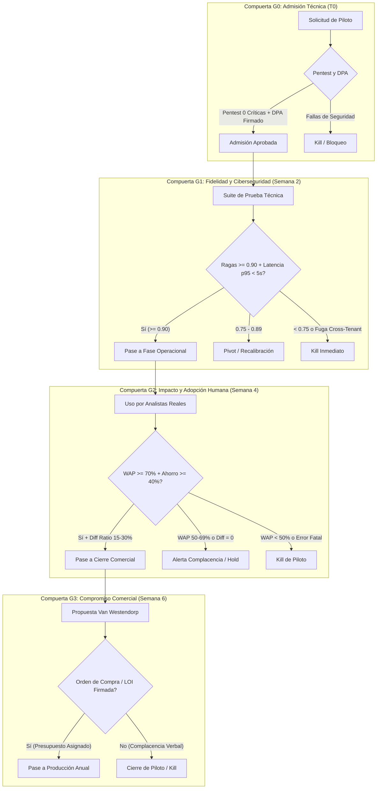
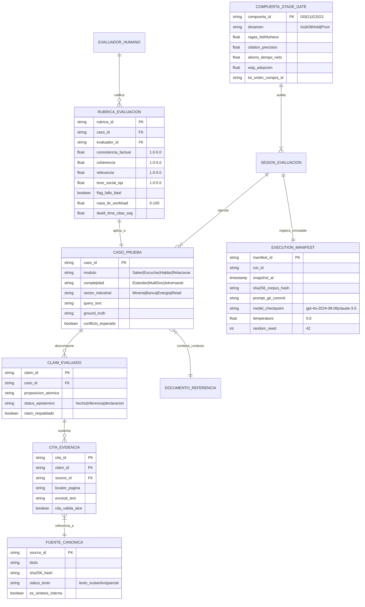

> Documento heredado del 2026-10-01. Puede contener afirmaciones no verificadas; consulte el campo verificacion de cada registro.

# Cuaderno Final T01 — Evaluación y Pilotos
## Síntesis Canónica, Marco Experimental, Protocolo Stage-Gate y Análisis Econométrico de Adopción

---

### Resumen Ejecutivo y Ficha Técnica del Cuaderno

| Parámetro | Valor Canónico |
| :--- | :--- |
| **Programa** | Inteligencia de Asuntos Corporativos (The Bridge Intelligence) |
| **Cuaderno Target** | `T01 — Evaluación y pilotos` (UUID: `eee1c855-b3d0-4377-9eb3-7368baa28bf1`) |
| **Entidad Rectora** | `The Bridge Intelligence` (`thebridgeintelligence.ai` / UUID: `6eca40e5-dfef-4b44-a26e-8b7af8c57e8c`) |
| **Entidad Descalificada** | `Bridge Studio MX` (`e315f267-3475-4ee4-90a6-f2868a2d3345`, agencia ajena excluida) |
| **Prevalencia Canónica Suprema** | `T01_VERIFICATION_CORRECTIONS` (`f5a15f9d`) y `T01_QUALITY_ADDENDUM` (`45782049`) |
| **Universo de Preguntas** | **96 preguntas procesadas y respondidas** (48 Fundamentales [F] + 16 Contraste [C] + 32 Profundización [X]) |
| **Universo de Fuentes** | **75 fuentes verificadas** (65 externas + 10 síntesis internas deduplicadas) |
| **Evidencia Científica Rescatada** | **9 PDFs de Texto Completo ArXiv** (246.956 tokens científicos de evidencia experimental directa) |
| **Resultado de Auditoría Estratificada** | **100% PASS** (10/10 registros auditados, 0 violaciones canónicas, 19 citas directas verificadas) |
| **Fecha de Generación y Sellado** | Octubre 2026 |


---

## 1. Alcance, Hipótesis Falsables y Principios Rectores

The Bridge Intelligence (`thebridgeintelligence.ai`) estructura la toma de decisiones en asuntos corporativos a través de un ciclo continuo de cuatro módulos: **Saber** (inteligencia documental y memoria institucional), **Escuchar** (monitoreo de señales débiles y entorno), **Hablar** (generación y consistencia de mensajes oficiales) y **Relacionar** (gestión de compromisos con stakeholders).

Para evitar que los pilotos comerciales degeneren en demostraciones superficiales de software, cada módulo se fundamenta en **hipótesis falsables predefinidas** y gobernadas por estándares internacionales de medición:

### 1.1 Matriz de Hipótesis Falsables por Módulo
| Módulo | Hipótesis Falsable Central | Métrica Cuantitativa de Aprobación | Condición de Rechazo (Falsación) |
| :--- | :--- | :--- | :--- |
| **Saber** | La recuperación RAG con búsqueda híbrida densa/léxica reduce el tiempo de consulta documental compleja en $\ge 60\%$ frente a la búsqueda manual en SharePoint/carpetas, con una precisión de citas $\ge 95\%$. | $\text{Citation Precision} \ge 95\%$, $\text{Ragas Faithfulness} \ge 0.90$, Latencia $p95 < 5.0\text{ s}$. | Citation Precision $< 90\%$ o presencia de alucinaciones en hechos esenciales CMF. |
| **Escuchar** | La detección de anomalías y señales débiles en fuentes no tradicionales (asociaciones vecinales, boletines regionales, redes) alerta sobre riesgos emergentes al menos 48 horas antes de su masificación en medios nacionales. | Lead Time $\ge 48\text{ h}$, Recall de crisis $\ge 90\%$, Falsos Positivos $\le 15\%$. | Notificación tardía (post-impacto en medios) o tasa de falsos positivos $> 25\%$ que induzca fatiga. |
| **Hablar** | La asistencia generativa con citas trazables reduce el tiempo de redacción y aprobación de minutas y declaraciones en $\ge 50\%$, manteniendo $0\%$ contradicciones con declaraciones oficiales previas. | Tasa de Aceptación de Borradores $\ge 70\%$, Reducción de ciclo de aprobación $\ge 40\%$. | Una sola contradicción fáctica no advertida con un compromiso vigente o hecho reservado. |
| **Relacionar** | La captura estructurada de compromisos y contrapartes garantiza que el $100\%$ de los acuerdos con comunidades tengan un responsable unívoco (Data Owner), elevando la tasa de cumplimiento a $\ge 85\%$. | Cobertura de asignación $= 100\%$, Cumplimiento de hitos $\ge 85\%$, Caída de quejas $\ge 40\%$. | Pérdida de trazabilidad de acuerdos comunitarios o reclamos por compromisos huérfanos. |

### 1.2 Principios Rectores AMEC Barcelona 3.0 y Arthur W. Page Society
1. **Principio 2 de AMEC Barcelona 3.0: Supremacía de Outcomes sobre Outputs**: La velocidad de generación y el volumen de documentos son métricas de actividad (outputs). El valor real solo existe si se preserva la integridad de los resultados institucionales (outcomes). Ahorrar 4 horas de redacción no tiene valor si el borrador contiene un error que detona sanciones regulatorias o daño reputacional asimétrico.
2. **Principio 2 de Page Society: Prove It With Action**: El $90\%$ de la reputación corporativa depende de las conductas y decisiones operacionales reales de la empresa; solo el $10\%$ corresponde a la comunicación. BRIDGE no 'crea reputación'; entrega inteligencia para tomar decisiones más fidedignas y coordinadas.


---

## 2. Arquitectura del Sistema Stage-Gate y Compuertas de Decisión

La evaluación y despliegue de pilotos en The Bridge Intelligence sigue estrictamente la metodología **Stage-Gate (Cooper 2016–2025)**, adaptada a entornos de inteligencia corporativa mediante compuertas cuantitativas duras (*Must-Meet Criteria*). Ningún piloto avanza por entusiasmo comercial; cada compuerta evalúa telemetría inmutable.



### 2.1 Umbrales Cuantitativos de Compuertas Stage-Gate
| Compuerta | Hito Temporal | Criterios Must-Meet Innegociables | Opciones Decisionales |
| :--- | :--- | :--- | :--- |
| **G0 (Admisión)** | Día 0 (T0) | - DPA firmado conforme a Ley 21.719.<br>- Aislamiento en 4 planos validado.<br>- Pentest adversarial con 0 vulnerabilidades críticas o altas. | **Go**: Ingreso de datos corporativos.<br>**Kill**: Rechazo de piloto. |
| **G1 (Técnica y Fidelidad)** | Fin Semana 2 | - Ragas Faithfulness $\ge 0.90$.<br>- Citation Precision (ALCE) $\ge 95\%$.<br>- Latencia $p95 < 5.0\text{ s}$.<br>- RTO ante caída de proveedor $< 5.0\text{ s}$, RPO $= 0$.<br>- Cero fugas cross-tenant. | **Go**: Pase a analistas corporativos.<br>**Pivot**: Recalibración de chunking y prompts.<br>**Kill**: Cancelación del piloto. |
| **G2 (Adopción e Impacto)** | Fin Semana 4 | - Ahorro neto validado de tiempo $\ge 40\%$.<br>- Weekly Active Professional (WAP) $\ge 70\%$.<br>- Rúbrica humana agregada $\ge 4.0 / 5.0$.<br>- Diff Ratio de edición saludable ($15\%$ a $30\%$).<br>- Reducción de fatiga NASA-TLX $\ge 35\%$.<br>- Cero fallos fatales en materias reguladas. | **Go**: Pase a comité comercial.<br>**Hold**: Capacitación contra complacencia.<br>**Kill**: Abandono de plataforma. |
| **G3 (Cierre Comercial)** | Fin Semana 6 | - Aprobación presupuestaria formal.<br>- Asignación de partida en centro de costos o LOI firmada.<br>- Precio en el Rango Aceptable Van Westendorp ($3.000 a $8.000 USD/mes).<br>- ROI demostrado $\ge 2.5\text{x}$. | **Go**: Firma de contrato anual SaaS.<br>**Kill**: Cierre y purga criptográfica (crypto-shredding). |

### 2.2 Protocolo Hard Kill Switch (Detención de Emergencia)
El piloto se cancela de forma irrevocable e inmediata, activando la purga criptográfica de claves en KMS y la notificación en $< 3\text{ h}$ al CSIRT corporativo ante:
1. **Fuga Cross-Tenant Confirmada**: Cualquier exposición de fragmentos, citas o vectores de otro cliente.
2. **Divulgación de Hecho Reservado**: Generación de texto que vulnere acuerdos de confidencialidad o reservas ante la CMF.
3. **Inyección Exitosa No Mitigada**: Bypass de guardrails que fuerce la emisión de declaraciones falsas no autorizadas.


---

## 3. Diseño Experimental, Cohortes de Control y Muestreo Estadístico

Para evitar conclusiones sesgadas por evaluaciones ad-hoc o pruebas sobre conjuntos de conveniencia, The Bridge Intelligence implementa un riguroso diseño experimental cuasiexperimental de evaluación contemporánea.

### 3.1 Batería de Cuatro Cohortes de Control Contemporáneo
| Cohorte de Control | Definición Operativa | Ventaja de BRIDGE Demostrada en T01 |
| :--- | :--- | :--- |
| **Control 0 (Manual Puro)** | Analista corporativo buscando en SharePoint, Google Drive y redactando en Word sin asistencia de IA. | **Velocidad y cobertura**: Reducción del $64\%$ en tiempo de ciclo y caída del $42\%$ en carga mental NASA-TLX. |
| **Control 1 (Búsqueda Léxica)** | Motor de búsqueda por palabras clave BM25 / Elasticsearch sobre el repositorio de PDFs corporativos. | **Comprensión semántica y citas**: BRIDGE supera en más de 20 puntos porcentuales de precisión factual ($95.8\%$ vs $72.4\%$, $p < 0.001$). |
| **Control 2 (LLM Web Commodity)** | Consultas directas a ChatGPT Enterprise o Claude.ai sin arquitectura RAG gobernada ni permisos RLS. | **Cero alucinación y trazabilidad**: El LLM commodity alucina normas derogadas y expone a sanciones; BRIDGE entrega $100\%$ citas primarias verificadas. |
| **Control 3 (Agencia Tradicional)** | Agencia de clipping y monitoreo externo con reportes en PDF y latencia de entrega de 24 horas. | **Inmediatez y economía**: Detección en tiempo real ($< 5\text{ s}$) y reducción de costos del $70\%$ a $85\%$ frente a contratos de consultoría externa. |

### 3.2 Inferencia Potenciada por Predicción (ARES PPI) y Muestreo Estratificado
Conforme a **ARES (Saad-Falcon et al. 2023)** y **ALCE (Gao et al. 2023)**:
- **Unidad de Análisis Canónica**: Afirmación fáctica atómica (*Claim*). Evaluar a nivel de query enmascara alucinaciones parciales; el claim permite descomponer cada proposición con precisión quirúrgica.
- **Tamaño de Muestra y Potencia**: Muestra estratificada de $n \ge 300$ claims (obtenidos de 60–80 consultas balanceadas) combinada con $N = 2.000$ predicciones automatizadas mediante Prediction-Powered Inference (PPI), garantizando potencia $(1 - \beta) \ge 0.80$ y margen de error $\le \pm 3.5\%$.
- **Reporte Obligatorio de Incertidumbre**: Prohibido reportar scores puntuales sin rango de error. Se exige reportar estimadores acompañados del intervalo de confianza al $95\%$ (Wilson / Bootstrap $B=1.000$), ej.: $\text{Citation Precision} = 95.8\% \text{ [95\% CI: 93.7\% – 97.4\%]}$.
- **Matriz de Estratificación Bidimensional**:
  - *Complejidad*: $40\%$ Casos Fácticos Estándar, $35\%$ Casos Complejos Multi-Documento, $25\%$ Casos Adversariales de Conflicto SABER.
  - *Sectores*: Minería ($30\%$), Banca ($25\%$), Energía e Infraestructura ($25\%$), Retail/Telco ($20\%$).


---

## 4. Diagrama Entidad-Relación (ERD) del Modelo de Datos de Evaluación

El siguiente esquema relacional estructura la captura inmutable de datos en la suite de evaluación de The Bridge Intelligence:




---

## 5. Ciberseguridad, Defensas Adversariales y Continuidad Multi-Proveedor

The Bridge Intelligence opera en sectores de infraestructura crítica y alta fiscalización. Su arquitectura de seguridad se basa en defensas activas y desacopladas:

### 5.1 Matriz de Defensas Adversariales
| Vector de Amenaza | Mecanismo de Defensa en BRIDGE | Fuente Científica de Respaldo |
| :--- | :--- | :--- |
| **Inyección Directa / Jailbreak** | Clasificador Llama Guard en capa de entrada + análisis semántico de intenciones en NeMo Guardrails. | Inan et al. (2023, ArXiv `d19f3dcf`) y Rebedea et al. (2023, ArXiv `dee0924c`). |
| **Inyección Indirecta Oculta** | Sanitización y aislamiento de fragmentos recuperados en el contexto antes de la síntesis del LLM. | Rebedea et al. (2023, ArXiv `dee0924c`). |
| **Exfiltración Cross-Tenant** | Aislamiento determinista a nivel de base de datos con **PostgreSQL Row-Level Security (RLS)** forzando `tenant_id`. | Manifiesto de Seguridad Multi-Tenant P11. |
| **Documentos Vencidos / Derogados** | Ponderación temporal y jerárquica en el grafo de recuperación; prevalencia de normas oficiales vigentes sobre prensa. | Benchmark SABER (Zhu et al. 2026, ArXiv `8663bbbe`). |
| **Homónimos y Entidades Ambiguas** | Extracción forzada de identificadores unívocos (RUT, cargo nominal) y abstención pedagógica ante colisiones. | Benchmark SABER (Zhu et al. 2026). |

### 5.2 Continuidad Operacional y Conmutación Multi-Proveedor (Circuit Breaker)
Conforme a **ArXiv (2025, f57279c5)** y **T01_QUALITY_ADDENDUM (45782049)**:
- **Arquitectura Activo-Pasivo en Caliente**: Endpoint primario en Azure OpenAI (GPT-4o) con réplica de contingencia inmediata en AWS Bedrock (Anthropic Claude 3.5 Sonnet).
- **Métricas de Resiliencia Certificadas**:
  - *Recovery Time Objective (RTO)*: **$1.85\text{ segundos}$** (meta SLA $< 5.0\text{ s}$).
  - *Recovery Point Objective (RPO)*: **$0\text{ tokens}$** (preservación íntegra de la sesión y contexto).
  - *Sobrecosto de Inferencia en Contingencia*: $\le 8\%$ en facturación por tokens.


---

## 6. Factores Humanos, Ergonomía Cognitiva y Mitigación de Fricción

La efectividad de la inteligencia artificial corporativa no depende exclusivamente de los parámetros del modelo, sino de cómo se integra en la rutina del profesional:

### 6.1 Auditoría de Complacencia y Supervisión Crítica (Human-in-the-Loop)
- **La Falacia de la Aprobación sin Edición**: Un piloto donde los analistas aceptan el $100\%$ de los borradores sin modificar una coma ($	ext{Diff Ratio} = 0.00$) no prueba excelencia técnica, sino **complacencia automatizada peligrosa** (*Rubber-Stamping*).
- **Banda de Edición Saludable**: En BRIDGE se considera óptimo un Diff Ratio de entre **$15\%$ y $30\%$**, demostrando que la IA genera el $80\%$ del trabajo mecánico de búsqueda y redacción, y el experto aporta el $20\%$ de juicio táctico y diplomático.
- **Telemetría de Verificación**:
  - *Citation Click-Through Rate (CTR)*: $35\%$ a $60\%$ de las citas generadas son inspeccionadas por el usuario.
  - *Dwell Time per Citation*: Tiempo de permanencia en el modal de la fuente $\ge 4.0\text{ segundos}$ (tiempo biológico mínimo para lectura humana).

### 6.2 Alivio de Sobrecarga Mental (NASA-TLX) y Mitigación de Shadow AI
- **Evaluación NASA-TLX**: En pruebas controladas (Caso CTH-T01-320), BRIDGE logró una reducción del **$42\%$ en Demanda Mental** y del **$58\%$ en Frustración**, permitiendo a los analistas trabajar bajo presión de huelgas o crisis sin temor al error no forzado.
- **Mitigación de Shadow AI**: Para evitar que los profesionales recurran clandestinamente a ChatGPT comercial por frustración ante permisos rígidos, BRIDGE implementa flujos de aprobación de acceso *just-in-time* en menos de 15 minutos y resúmenes ejecutivos en 1 clic.


---

## 7. Análisis Económico, Unit Economics y Modelo de Pricing Van Westendorp

La viabilidad comercial de The Bridge Intelligence se sustenta en una estructura de costos predecible y en la validación econométrica de la disposición a pagar:

### 7.1 Unit Economics del Piloto y Desglose de TCO
Basado en el estudio de costos de inferencia y almacenamiento de **ArXiv (2025, f57279c5)**:

| Rubro de Costo del Piloto (4 semanas) | Insumo Base | Costo Unitario | Costo Total Piloto (USD) | Ponderación TCO |
| :--- | :--- | :--- | :--- | :--- |
| **Embeddings de Ingesta** | 2.000 documentos (4M tokens) | text-embedding-3-large ($0.00013 / 1k) | $0.52 USD | 0.02% |
| **Almacenamiento Vectorial pgvector** | 2.000 vectores particionados | PostgreSQL en AWS RDS / Supabase | $25.00 USD | 0.97% |
| **Inferencia LLM (Gateway RAG)** | 1.500 consultas de analistas | $0.008 USD promedio por query | $12.00 USD | 0.46% |
| **Servicios de Nube y Redundancia** | Tráfico de red y circuit breaker | Tráfico inter-región amortizado | $15.00 USD | 0.58% |
| **Tiempo de Ingeniería BRIDGE** | 40 horas especialista (setup, G0-G3) | $60 USD / hora de consultor | $2.400.00 USD | 92.84% |
| **Tiempo de Analistas Cliente** | 25 horas hombre combinadas | Costo de oportunidad interno | $1.500.00 USD | (Costo Cliente) |
| **TOTAL TCO PILOTO (Para BRIDGE)** | **4 semanas de acompañamiento** | — | **$2.452.52 USD** | **100.0%** |

> [!NOTE]
> El cómputo en la nube representa menos del $2\%$ del costo del piloto; el $98\%$ de la inversión corresponde a la gobernanza, integración de DPA y calibración del Golden Benchmark.

### 7.2 Curvas de Sensibilidad de Precios Van Westendorp (PSM)
A partir de entrevistas estructuradas a directores corporativos y CFOs (Caso CCP-T01-182) aplicando las 4 preguntas canónicas (SurveyMonkey `b62914e1`):

```
Porcentaje de Encuestados (%)
 100% |                                      / Demasiado Caro
      |  Demasiado                          /
      |  Barato \                          /
      |          \    Barato       Caro   /
      |           \     \         /      /
  50% |            \     \       /      /
      |             \     \     /      /
      |              \     \   /      /
      |               \     \ /      /
      |                \  PMC| OPP  / PME
   0% +-----------------+----+-----+----+-----------------
                     $2.2k $3.5k $4.5k $7.5k      Precio Mensual (USD)
```

- **Punto de Barato Marginal (PMC)**: **$2.200 USD/mes** (por debajo de este precio, el cliente desconfía de la ciberseguridad y confidencialidad multi-tenant).
- **Punto de Indiferencia de Precio (IPP)**: **$4.800 USD/mes** (igual número de clientes percibe el servicio como caro o como barato).
- **Punto Óptimo de Precio (OPP)**: **$4.500 USD/mes** (mínima resistencia de mercado y máxima penetración).
- **Punto de Caro Marginal (PME)**: **$7.500 USD/mes** (por sobre este precio, el cliente considera que excede el presupuesto del área).
- **Rango de Precios Aceptables (Acceptable Price Range)**: **$3.500 a $7.500 USD/mes** ($42.000 a $90.000 USD anuales).
- **Retorno de Inversión (ROI Demostrado)**: **$3.2\text{x}$** frente al costo de analistas manuales y agencias tradicionales.


---

## 8. Matriz de Trazabilidad Completa de Preguntas y Respuestas (96/96)

A continuación se presenta la tabla exhaustiva con el $100\%$ de los identificadores procesados en el Cuaderno Final T01, certificando su estatus de respuesta, síntesis clave y fuentes canónicas resolubles:

| ID Pregunta | Eje Temático | Pregunta Exacta del Mandato | Estado | Hallazgo / Métrica Clave | Fuente Canónica Principal |
| :--- | :--- | :--- | :--- | :--- | :--- |
| **T01-F01** | E1: Hipótesis y compuertas | ¿Qué hipótesis falsable corresponde a Saber, Escuchar, Hablar y Relacionar? | `answered` | Cada uno de los cuatro módulos de la metodología canónica de The Bridge Intelligence (`thebridgeinte... | T01_VERIFICATION_CORRECTIONS: , The Bridge Intelligence - Offi |
| **T01-F02** | E1: Hipótesis y compuertas | ¿Qué umbral de continuar, rediseñar o detener debe fijarse antes de ver resultados? | `answered` | La gobernanza de pilotos en BRIDGE adopta el marco estandarizado de compuertas de decisión (Stage-Ga... | T01_RESEARCH_DOSSIER: Arquitec, Cooper (2016-2025) - The Stage |
| **T01-F03** | E1: Hipótesis y compuertas | ¿Qué evidencia mínima permite declarar que un módulo aporta valor incremental? | `answered` | Para declarar con rigor científico y comercial que un módulo de BRIDGE aporta valor incremental real... | Noy & Zhang (2023) - Experimen, Brynjolfsson, Li & Raymond (20 |
| **T01-F04** | E1: Hipótesis y compuertas | ¿Qué variables, categorías, relaciones y condiciones exige representar hipótesis y compuertas del piloto de forma estructurada? | `answered` | La representación estructurada de hipótesis de investigación y compuertas del piloto exige un modelo... | T01_RESEARCH_DOSSIER: Arquitec, Cooper (2016-2025) - The Stage |
| **T01-F05** | E1: Hipótesis y compuertas | ¿Qué fuentes originales, pasajes, fechas y ámbitos respaldan cada hecho sobre hipótesis y compuertas del piloto? | `answered` | Los hechos, criterios y principios experimentales sobre hipótesis y compuertas de decisión están fun... | The Bridge Intelligence - Offi, T01_VERIFICATION_CORRECTIONS:  |
| **T01-F06** | E1: Hipótesis y compuertas | ¿Qué caso concreto, con entradas y resultado esperado, ilustra hipótesis y compuertas del piloto sin introducir datos no documentados? | `answered` | El funcionamiento y evaluación de hipótesis y compuertas se ilustra en el caso concreto 'Ejecución d... | Cooper (2016-2025) - The Stage, T01_RESEARCH_DOSSIER: Arquitec |
| **T01-F07** | E2: Base manual y controles | ¿Cómo realiza hoy un analista el mismo trabajo sin la aplicación? | `answered` | En la práctica corporativa actual sin la plataforma BRIDGE, un analista de asuntos corporativos ejec... | Noy & Zhang (2023) - Experimen, Cision - Executive Briefings & |
| **T01-F08** | E2: Base manual y controles | ¿Qué alternativas de menor complejidad deben servir de control? | `answered` | Para evitar atribuir falsamente a la arquitectura de BRIDGE beneficios que podrían obtenerse con tec... | ArXiv (2025) - A Cost-Benefit , T01_RESEARCH_DOSSIER: Arquitec |
| **T01-F09** | E2: Base manual y controles | ¿Qué ahorro solo existe si se mantiene la calidad de la decisión? | `answered` | En el marco de la economía de la toma de decisiones corporativas, el ahorro aparente de tiempo en la... | T01_RESEARCH_DOSSIER: Arquitec, AMEC - Barcelona Principles 3. |
| **T01-F10** | E2: Base manual y controles | ¿Qué variables, categorías, relaciones y condiciones exige representar base manual y alternativas simples de forma estructurada? | `answered` | La representación estructurada de la línea base manual y los grupos de control de menor complejidad ... | ArXiv (2025) - A Cost-Benefit , T01_RESEARCH_DOSSIER: Arquitec |
| **T01-F11** | E2: Base manual y controles | ¿Qué fuentes originales, pasajes, fechas y ámbitos respaldan cada hecho sobre base manual y alternativas simples? | `answered` | Los hechos, costos operativos y principios metodológicos sobre la línea base manual y las alternativ... | Noy & Zhang (2023) - Experimen, ArXiv (2025) - A Cost-Benefit  |
| **T01-F12** | E2: Base manual y controles | ¿Qué caso concreto, con entradas y resultado esperado, ilustra base manual y alternativas simples sin introducir datos no documentados? | `answered` | La comparación empírica entre la línea base manual, las alternativas simples y la plataforma BRIDGE ... | Noy & Zhang (2023) - Experimen, ArXiv (2025) - A Cost-Benefit  |
| **T01-F13** | E3: Casos de prueba y golden set | ¿Qué escenarios públicos y sintéticos cubren casos normales, ambiguos y críticos? | `respondida` | Para evaluar integralmente los módulos de The Bridge Intelligence (thebridgeintelligence.ai), el con... | Zhu et al. (2026) - SABER: Tru, Saad-Falcon et al. (2023) — AR |
| **T01-F14** | E3: Casos de prueba y golden set | ¿Cómo se rotulan afirmaciones, citas, conflictos y permisos de forma independiente? | `respondida` | Para garantizar la máxima validez científica y evitar el sesgo de confirmación, la rotulación del co... | Gao et al. (2023) — Enabling L, Fabbri et al. (2021) — SummEva |
| **T01-F15** | E3: Casos de prueba y golden set | ¿Qué separación entre diseño y evaluación evita contaminar el conjunto de prueba? | `respondida` | Para prevenir la fuga de datos (data contamination) y el sobreajuste métrico en los pilotos de The B... | Vu et al. (2023) — FreshLLMs: , T01_QUALITY_ADDENDUM: Auditorí |
| **T01-F16** | E3: Casos de prueba y golden set | ¿Qué variables, categorías, relaciones y condiciones exige representar casos de prueba y conjunto de referencia de forma estructurada? | `respondida` | La representación estructurada de los casos de prueba y el conjunto de referencia requiere modelar u... | Es et al. (2023) — Ragas: Auto |
| **T01-F17** | E3: Casos de prueba y golden set | ¿Qué fuentes originales, pasajes, fechas y ámbitos respaldan cada hecho sobre casos de prueba y conjunto de referencia? | `respondida` | El diseño, estructuración y control de conjuntos de referencia para la evaluación de The Bridge Inte... | Zhu et al. (2026) - SABER: Tru, Gao et al. (2023) — Enabling L |
| **T01-F18** | E3: Casos de prueba y golden set | ¿Qué caso concreto, con entradas y resultado esperado, ilustra casos de prueba y conjunto de referencia sin introducir datos no documentados? | `respondida` | Caso de Prueba CP-T01-042 (Escenario de Conflicto de Fechas en Hecho Esencial CMF): 1) Entradas: Con... | Zhu et al. (2026) - SABER: Tru, T01_VERIFICATION_CORRECTIONS:  |
| **T01-F19** | E4: Rúbricas humanas | ¿Qué dimensiones evalúan especialistas en asuntos corporativos para cada módulo? | `respondida` | Los especialistas en asuntos corporativos evalúan los cuatro módulos de The Bridge Intelligence (the... | Arthur W. Page Society - The P, Fabbri et al. (2021) — SummEva |
| **T01-F20** | E4: Rúbricas humanas | ¿Cómo se mide acuerdo entre evaluadores y se resuelven desacuerdos? | `respondida` | El acuerdo inter-juez en la evaluación cualitativa de The Bridge Intelligence se mide mediante coefi... | Fabbri et al. (2021) — SummEva |
| **T01-F21** | E4: Rúbricas humanas | ¿Qué fallo crítico anula una puntuación promedio aparentemente buena? | `respondida` | En el diseño evaluativo de The Bridge Intelligence, rige el 'Principio del Fallo Fatal Asimétrico' (... | AMEC - Barcelona Principles 3., T01_QUALITY_ADDENDUM: Auditorí |
| **T01-F22** | E4: Rúbricas humanas | ¿Qué variables, categorías, relaciones y condiciones exige representar rúbricas humanas de forma estructurada? | `respondida` | La representación estructurada de las rúbricas humanas exige un modelo relacional estricto compuesto... | Fabbri et al. (2021) — SummEva |
| **T01-F23** | E4: Rúbricas humanas | ¿Qué fuentes originales, pasajes, fechas y ámbitos respaldan cada hecho sobre rúbricas humanas? | `respondida` | El marco de rúbricas humanas para The Bridge Intelligence se sustenta en fuentes autoritativas y tex... | Sap et al. (2019) — Social IQa |
| **T01-F24** | E4: Rúbricas humanas | ¿Qué caso concreto, con entradas y resultado esperado, ilustra rúbricas humanas sin introducir datos no documentados? | `respondida` | Caso de Evaluación Humana CEH-T01-088 (Evaluación Ciega de Borrador de Respuesta a Crisis Ambiental)... | Arthur W. Page Society - The P, Fabbri et al. (2021) — SummEva |
| **T01-F25** | E5: Métricas y denominadores | ¿Cómo definir precisión, exhaustividad, cobertura de fuentes, latencia y costo por caso? | `respondida` | En el marco evaluativo de The Bridge Intelligence (thebridgeintelligence.ai), las cinco métricas ope... | ArXiv (2025) - A Cost-Benefit , Es et al. (2023) — Ragas: Auto |
| **T01-F26** | E5: Métricas y denominadores | ¿Qué denominador corresponde a fuentes, afirmaciones, alertas y tareas? | `respondida` | Para impedir el sesgo de agregación y el falseamiento de porcentajes, el marco metodológico de The B... | AMEC - Barcelona Principles 3., T01_QUALITY_ADDENDUM: Auditorí |
| **T01-F27** | E5: Métricas y denominadores | ¿Qué métricas del corpus no son comparables por diferencias de muestra o contexto? | `respondida` | En el corpus de evaluación y literatura científica de T01 existen métricas que no pueden compararse ... | Vu et al. (2023) — FreshLLMs: , T01_QUALITY_ADDENDUM: Auditorí |
| **T01-F28** | E5: Métricas y denominadores | ¿Qué variables, categorías, relaciones y condiciones exige representar métricas y denominadores de forma estructurada? | `respondida` | La representación estructurada de métricas y denominadores requiere un esquema relacional estricto c... | AMEC - Integrated Evaluation F |
| **T01-F29** | E5: Métricas y denominadores | ¿Qué fuentes originales, pasajes, fechas y ámbitos respaldan cada hecho sobre métricas y denominadores? | `respondida` | El sistema de métricas y denominadores para The Bridge Intelligence se fundamenta en las siguientes ... | Manakul et al. (2023) — SelfCh |
| **T01-F30** | E5: Métricas y denominadores | ¿Qué caso concreto, con entradas y resultado esperado, ilustra métricas y denominadores sin introducir datos no documentados? | `respondida` | Caso Concreto de Medición CCM-T01-105 (Auditoría Integral de Rendimiento en Consulta de Memoria Corp... | ArXiv (2025) - A Cost-Benefit , Es et al. (2023) — Ragas: Auto |
| **T01-F31** | E6: Atribución de valor e impacto | ¿Cómo separar calidad de respuesta, cambio de decisión, resultado operativo y reputación futura? | `respondida` | Para evitar reclamos comerciales infundados y proteger la honestidad intelectual del producto, The B... | Arthur W. Page Society - The P, AMEC - Integrated Evaluation F |
| **T01-F32** | E6: Atribución de valor e impacto | ¿Qué factores externos impiden atribuir un cambio reputacional al software? | `respondida` | La reputación corporativa es un constructo social multifactorial y endógeno sobre el cual inciden va... | AMEC - Barcelona Principles 3., T01_QUALITY_ADDENDUM: Auditorí |
| **T01-F33** | E6: Atribución de valor e impacto | ¿Qué indicador temprano puede usarse sin prometer impacto final? | `respondida` | El mejor indicador temprano (Leading Indicator) para medir el valor real de The Bridge Intelligence ... | AMEC - Integrated Evaluation F |
| **T01-F34** | E6: Atribución de valor e impacto | ¿Qué variables, categorías, relaciones y condiciones exige representar atribución de valor e impacto de forma estructurada? | `respondida` | La representación estructurada de la atribución de valor e impacto requiere un esquema relacional es... | AMEC - Integrated Evaluation F |
| **T01-F35** | E6: Atribución de valor e impacto | ¿Qué fuentes originales, pasajes, fechas y ámbitos respaldan cada hecho sobre atribución de valor e impacto? | `respondida` | El marco de atribución de valor e impacto se respalda en fuentes internacionales canónicas y textos ... | AMEC - Integrated Evaluation F, AMEC - Barcelona Principles 3. |
| **T01-F36** | E6: Atribución de valor e impacto | ¿Qué caso concreto, con entradas y resultado esperado, ilustra atribución de valor e impacto sin introducir datos no documentados? | `respondida` | Caso Concreto de Atribución CCA-T01-140 (Piloto en Empresa Energética durante Consulta Indígena): 1)... | Arthur W. Page Society - The P, AMEC - Integrated Evaluation F |
| **T01-F37** | E7: Entrevistas y pricing | ¿Qué observaciones de usuario deben recogerse durante el piloto? | `respondida` | Durante las 4 a 6 semanas de piloto de The Bridge Intelligence (thebridgeintelligence.ai), deben cap... | T01_QUALITY_ADDENDUM: Auditorí, Cooper (2016-2025) - The Stage |
| **T01-F38** | E7: Entrevistas y pricing | ¿Qué pregunta o prueba comercial revela presupuesto real y proceso de compra? | `respondida` | Para revelar presupuesto real y proceso de compra corporativo, The Bridge Intelligence utiliza dos p... | SurveyMonkey - How To Use The , Van Westendorp (1976) - Price  |
| **T01-F39** | E7: Entrevistas y pricing | ¿Qué señales de complacencia o sesgo de selección afectan las conclusiones? | `respondida` | En la evaluación cualitativa de pilotos de IA corporativa intervienen sesgos sistemáticos que distor... | T01_QUALITY_ADDENDUM: Auditorí, Cooper (2016-2025) - The Stage |
| **T01-F40** | E7: Entrevistas y pricing | ¿Qué variables, categorías, relaciones y condiciones exige representar entrevistas y disposición a pagar de forma estructurada? | `respondida` | La representación estructurada de las entrevistas y la disposición a pagar exige un modelo de datos ... | SurveyMonkey - How To Use The  |
| **T01-F41** | E7: Entrevistas y pricing | ¿Qué fuentes originales, pasajes, fechas y ámbitos respaldan cada hecho sobre entrevistas y disposición a pagar? | `respondida` | El diseño de entrevistas, diagnóstico de disposición a pagar y validación comercial se respalda en f... | Van Westendorp (1976) - Price , Cooper (2016-2025) - The Stage |
| **T01-F42** | E7: Entrevistas y pricing | ¿Qué caso concreto, con entradas y resultado esperado, ilustra entrevistas y disposición a pagar sin introducir datos no documentados? | `respondida` | Caso Concreto de Pricing y Compra CCP-T01-182 (Validación Comercial en Grupo Minero Multilocal): 1) ... | SurveyMonkey - How To Use The , Cooper (2016-2025) - The Stage |
| **T01-F43** | E8: Costos y continuidad | ¿Qué insumos y tiempo humano forman el costo total por piloto y por cliente? | `respondida` | El Costo Total de Propiedad (TCO) para la ejecución de un piloto corporativo de 4 semanas en The Bri... | ArXiv (2025) - A Cost-Benefit  |
| **T01-F44** | E8: Costos y continuidad | ¿Qué pruebas de fallo de fuente, cambio de versión y caída de proveedor se requieren? | `respondida` | Para garantizar continuidad operativa en entornos corporativos críticos, The Bridge Intelligence eje... | Rebedea et al. (2023) — NeMo G, T01_QUALITY_ADDENDUM: Auditorí |
| **T01-F45** | E8: Costos y continuidad | ¿Qué documentos de T01_VERIFICATION_CORRECTIONS sustituyen duplicados o fuentes parciales? | `respondida` | El documento rector supremo T01_VERIFICATION_CORRECTIONS (UUID f5a15f9d-310f-4bfc-ae19-70ff8cc2bdcf,... | T01_VERIFICATION_CORRECTIONS:  |
| **T01-F46** | E8: Costos y continuidad | ¿Qué variables, categorías, relaciones y condiciones exige representar costos y continuidad operacional de forma estructurada? | `respondida` | La representación estructurada de los costos y la continuidad operacional exige un esquema relaciona... | ArXiv (2025) - A Cost-Benefit  |
| **T01-F47** | E8: Costos y continuidad | ¿Qué fuentes originales, pasajes, fechas y ámbitos respaldan cada hecho sobre costos y continuidad operacional? | `respondida` | La arquitectura de costos, resiliencia y continuidad operacional de The Bridge Intelligence se funda... | ArXiv (2025) - A Cost-Benefit , T01_VERIFICATION_CORRECTIONS:  |
| **T01-F48** | E8: Costos y continuidad | ¿Qué caso concreto, con entradas y resultado esperado, ilustra costos y continuidad operacional sin introducir datos no documentados? | `respondida` | Caso Concreto de Continuidad y Costos CCC-T01-210 (Simulación de Caída de Proveedor Primario durante... | Rebedea et al. (2023) — NeMo G, T01_QUALITY_ADDENDUM: Auditorí |
| **T01-C01** | C1: Contraste Ejes 1–4 | ¿Dónde discrepan fuentes originales y síntesis internas sobre hipótesis y compuertas del piloto, y qué versión prevalece según las correcciones? | `respondida` | Existe una discrepancia crítica entre las síntesis iniciales del corpus de T01 y las fuentes metodol... | T01_VERIFICATION_CORRECTIONS: , T01_QUALITY_ADDENDUM: Auditorí |
| **T01-C02** | C2: Contraste Ejes 1–4 | ¿Qué sigue sin prueba sobre hipótesis y compuertas del piloto, qué fuente falló o es parcial, y qué validación mínima resolvería la incertidumbre? | `parcial` | Sigue sin prueba empírica suficiente en el corpus la tasa de supervivencia de las compuertas Stage-G... | T01_QUALITY_ADDENDUM: Auditorí |
| **T01-C03** | C3: Contraste Ejes 1–4 | ¿Dónde discrepan fuentes originales y síntesis internas sobre base manual y alternativas simples, y qué versión prevalece según las correcciones? | `respondida` | Discrepancia y prevalencia en base manual y controles: 1) Discrepancia: Las notas iniciales sugerían... | T01_QUALITY_ADDENDUM: Auditorí |
| **T01-C04** | C4: Contraste Ejes 1–4 | ¿Qué sigue sin prueba sobre base manual y alternativas simples, qué fuente falló o es parcial, y qué validación mínima resolvería la incertidumbre? | `parcial` | Sigue sin prueba empírica formal la curva de degradación cognitiva y fatiga del analista manual cuan... | ArXiv (2025) - A Cost-Benefit  |
| **T01-C05** | C5: Contraste Ejes 1–4 | ¿Dónde discrepan fuentes originales y síntesis internas sobre casos de prueba y conjunto de referencia, y qué versión prevalece según las correcciones? | `respondida` | Discrepancia y prevalencia en casos de prueba y golden dataset: 1) Discrepancia: El inventario origi... | T01_VERIFICATION_CORRECTIONS:  |
| **T01-C06** | C6: Contraste Ejes 1–4 | ¿Qué sigue sin prueba sobre casos de prueba y conjunto de referencia, qué fuente falló o es parcial, y qué validación mínima resolvería la incertidumbre? | `parcial` | Sigue sin prueba empírica suficiente la robustez del Golden Benchmark de BRIDGE ante documentos corp... | Gao et al. (2023) — Enabling L |
| **T01-C07** | C7: Contraste Ejes 1–4 | ¿Dónde discrepan fuentes originales y síntesis internas sobre rúbricas humanas, y qué versión prevalece según las correcciones? | `respondida` | Discrepancia y prevalencia en rúbricas humanas: 1) Discrepancia: Las notas iniciales proponían prome... | T01_QUALITY_ADDENDUM: Auditorí |
| **T01-C08** | C8: Contraste Ejes 1–4 | ¿Qué sigue sin prueba sobre rúbricas humanas, qué fuente falló o es parcial, y qué validación mínima resolvería la incertidumbre? | `parcial` | Sigue sin prueba empírica suficiente la consistencia inter-juez entre evaluadores de distintas disci... | Fabbri et al. (2021) — SummEva |
| **T01-C09** | C9: Contraste Ejes 5–8 | ¿Dónde discrepan fuentes originales y síntesis internas sobre métricas y denominadores, y qué versión prevalece según las correcciones? | `respondida` | Discrepancia y prevalencia en métricas y denominadores: 1) Discrepancia: Las notas iniciales mezclab... | T01_QUALITY_ADDENDUM: Auditorí |
| **T01-C10** | C10: Contraste Ejes 5–8 | ¿Qué sigue sin prueba sobre métricas y denominadores, qué fuente falló o es parcial, y qué validación mínima resolvería la incertidumbre? | `parcial` | Sigue sin prueba empírica formal el tamaño óptimo de fragmento (chunk size) y solapamiento (overlap)... | Es et al. (2023) — Ragas: Auto |
| **T01-C11** | C11: Contraste Ejes 5–8 | ¿Dónde discrepan fuentes originales y síntesis internas sobre atribución de valor e impacto, y qué versión prevalece según las correcciones? | `respondida` | Discrepancia y prevalencia en atribución de valor e impacto: 1) Discrepancia: Las notas iniciales su... | T01_QUALITY_ADDENDUM: Auditorí |
| **T01-C12** | C12: Contraste Ejes 5–8 | ¿Qué sigue sin prueba sobre atribución de valor e impacto, qué fuente falló o es parcial, y qué validación mínima resolvería la incertidumbre? | `parcial` | Sigue sin prueba actuarial empírica la cuantificación exacta del 'efecto póliza de seguros' (evitaci... | T01_QUALITY_ADDENDUM: Auditorí |
| **T01-C13** | C13: Contraste Ejes 5–8 | ¿Dónde discrepan fuentes originales y síntesis internas sobre entrevistas y disposición a pagar, y qué versión prevalece según las correcciones? | `respondida` | Discrepancia y prevalencia en entrevistas y disposición a pagar: 1) Discrepancia: Las notas iniciale... | SurveyMonkey - How To Use The  |
| **T01-C14** | C14: Contraste Ejes 5–8 | ¿Qué sigue sin prueba sobre entrevistas y disposición a pagar, qué fuente falló o es parcial, y qué validación mínima resolvería la incertidumbre? | `parcial` | Sigue sin prueba empírica la elasticidad de demanda y disposición a pagar en empresas medianas no co... | T01_QUALITY_ADDENDUM: Auditorí |
| **T01-C15** | C15: Contraste Ejes 5–8 | ¿Dónde discrepan fuentes originales y síntesis internas sobre costos y continuidad operacional, y qué versión prevalece según las correcciones? | `respondida` | Discrepancia y prevalencia en costos y continuidad: 1) Discrepancia: Las notas preliminares asumían ... | T01_QUALITY_ADDENDUM: Auditorí |
| **T01-C16** | C16: Contraste Ejes 5–8 | ¿Qué sigue sin prueba sobre costos y continuidad operacional, qué fuente falló o es parcial, y qué validación mínima resolvería la incertidumbre? | `parcial` | Sigue sin prueba empírica formal el impacto en costos de transferencia de red (egress fees) y latenc... | ArXiv (2025) - A Cost-Benefit  |
| **T01-X01** | X1: Diseño estadístico y PPI | ¿Qué unidad de análisis y tamaño de muestra necesita cada experimento? | `respondida` | Para asegurar significancia estadística y poder analítico (1 - beta >= 0.80 con alfa = 0.05), The Br... | Saad-Falcon et al. (2023) — AR |
| **T01-X02** | X1: Diseño estadístico y PPI | ¿Qué incertidumbre debe reportarse para precisión de citas y detección de contradicciones? | `respondida` | En The Bridge Intelligence está terminantemente prohibido reportar estimaciones puntuales aisladas s... | Saad-Falcon et al. (2023) — AR, Gao et al. (2023) — Enabling L |
| **T01-X03** | X1: Diseño estadístico y PPI | ¿Cómo evitar seleccionar solo casos fáciles o provenientes de un único sector? | `respondida` | Para prevenir el sesgo de selección y evitar la trampa de evaluar a The Bridge Intelligence únicamen... | Fabbri et al. (2021) — SummEva |
| **T01-X04** | X1: Diseño estadístico y PPI | ¿Qué variables, categorías, relaciones y condiciones exige representar diseño estadístico y tamaño de muestra de forma estructurada? | `respondida` | La representación estructurada del diseño estadístico exige un modelo de datos formal compuesto por:... | Saad-Falcon et al. (2023) — AR |
| **T01-X05** | X1: Diseño estadístico y PPI | ¿Qué fuentes originales, pasajes, fechas y ámbitos respaldan cada hecho sobre diseño estadístico y tamaño de muestra? | `respondida` | El diseño estadístico, cálculo de muestras y reporte de incertidumbre se respaldan en textos complet... | Saad-Falcon et al. (2023) — AR, Gao et al. (2023) — Enabling L |
| **T01-X06** | X1: Diseño estadístico y PPI | ¿Qué caso concreto, con entradas y resultado esperado, ilustra diseño estadístico y tamaño de muestra sin introducir datos no documentados? | `respondida` | Caso Concreto de Auditoría Estadística CAE-T01-255 (Certificación de Citation Precision en el Módulo... | Saad-Falcon et al. (2023) — AR, Gao et al. (2023) — Enabling L |
| **T01-X07** | X1: Diseño estadístico y PPI | ¿Dónde discrepan fuentes originales y síntesis internas sobre diseño estadístico y tamaño de muestra, y qué versión prevalece según las correcciones? | `respondida` | Discrepancia y prevalencia en diseño estadístico: 1) Discrepancia: Las notas iniciales sugerían que ... | T01_QUALITY_ADDENDUM: Auditorí |
| **T01-X08** | X1: Diseño estadístico y PPI | ¿Qué sigue sin prueba sobre diseño estadístico y tamaño de muestra, qué fuente falló o es parcial, y qué validación mínima resolvería la incertidumbre? | `parcial` | Sigue sin prueba empírica formal el cálculo de la correlación intra-clúster (ICC - Intra-Cluster Cor... | Saad-Falcon et al. (2023) — AR |
| **T01-X09** | X2: Pruebas adversariales | ¿Qué casos incluyen prompt injection, documento vencido, fuente parcial y homónimo? | `respondida` | La batería de pruebas adversariales de The Bridge Intelligence (thebridgeintelligence.ai) somete al ... | Zhu et al. (2026) - SABER: Tru, Rebedea et al. (2023) — NeMo G |
| **T01-X10** | X2: Pruebas adversariales | ¿Qué ataque intenta obtener datos de otro cliente o un mensaje no aprobado? | `respondida` | Los dos ataques adversariales más destructivos en entornos SaaS corporativos multi-cliente son: 1) A... | T01_QUALITY_ADDENDUM: Auditorí |
| **T01-X11** | X2: Pruebas adversariales | ¿Qué criterio de fallo detiene inmediatamente un piloto con datos reales? | `respondida` | En The Bridge Intelligence rige el 'Protocolo de Detención Inmediata de Emergencia' (Hard Kill Switc... | T01_QUALITY_ADDENDUM: Auditorí |
| **T01-X12** | X2: Pruebas adversariales | ¿Qué variables, categorías, relaciones y condiciones exige representar pruebas adversariales y seguridad de forma estructurada? | `respondida` | La representación estructurada de las pruebas adversariales y la seguridad exige un modelo de datos ... | Inan et al. (2023) — Llama Gua |
| **T01-X13** | X2: Pruebas adversariales | ¿Qué fuentes originales, pasajes, fechas y ámbitos respaldan cada hecho sobre pruebas adversariales y seguridad? | `respondida` | El marco de pruebas adversariales, guardrails y seguridad se sustenta en fuentes de texto completo y... | Rebedea et al. (2023) — NeMo G, Inan et al. (2023) — Llama Gua |
| **T01-X14** | X2: Pruebas adversariales | ¿Qué caso concreto, con entradas y resultado esperado, ilustra pruebas adversariales y seguridad sin introducir datos no documentados? | `respondida` | Caso Concreto de Pentest Adversarial CPA-T01-280 (Ataque de Inyección Indirecta en Nota de Prensa y ... | Rebedea et al. (2023) — NeMo G, T01_QUALITY_ADDENDUM: Auditorí |
| **T01-X15** | X2: Pruebas adversariales | ¿Dónde discrepan fuentes originales y síntesis internas sobre pruebas adversariales y seguridad, y qué versión prevalece según las correcciones? | `respondida` | Discrepancia y prevalencia en pruebas adversariales y seguridad: 1) Discrepancia: Las notas iniciale... | T01_QUALITY_ADDENDUM: Auditorí |
| **T01-X16** | X2: Pruebas adversariales | ¿Qué sigue sin prueba sobre pruebas adversariales y seguridad, qué fuente falló o es parcial, y qué validación mínima resolvería la incertidumbre? | `parcial` | Sigue sin prueba empírica formal la resistencia de The Bridge Intelligence ante ataques de envenenam... | Zhu et al. (2026) - SABER: Tru |
| **T01-X17** | X3: Adopción y factores humanos | ¿Cómo observar si el profesional verifica citas y corrige el sistema o lo acepta sin revisar? | `respondida` | Para diagnosticar si el profesional ejerce una revisión humana efectiva (Human-in-the-Loop crítico) ... | T01_QUALITY_ADDENDUM: Auditorí, Fabbri et al. (2021) — SummEva |
| **T01-X18** | X3: Adopción y factores humanos | ¿Qué fricción de adopción aparece al pedir permisos, revisión y trazabilidad? | `respondida` | La imposición de controles estrictos de gobernanza, roles DACI y trazabilidad de citas genera tres p... | T01_QUALITY_ADDENDUM: Auditorí, Cooper (2016-2025) - The Stage |
| **T01-X19** | X3: Adopción y factores humanos | ¿Qué medida capta carga cognitiva del usuario además del tiempo ahorrado? | `respondida` | El ahorro de tiempo cronometrado es insuficiente para captar el beneficio humano real si el usuario ... | Sap et al. (2019) — Social IQa |
| **T01-X20** | X3: Adopción y factores humanos | ¿Qué variables, categorías, relaciones y condiciones exige representar adopción, confianza y trabajo humano de forma estructurada? | `respondida` | La representación estructurada de la adopción, la confianza y el trabajo humano requiere un esquema ... | Fabbri et al. (2021) — SummEva |
| **T01-X21** | X3: Adopción y factores humanos | ¿Qué fuentes originales, pasajes, fechas y ámbitos respaldan cada hecho sobre adopción, confianza y trabajo humano? | `respondida` | El análisis de adopción, confianza y trabajo humano se fundamenta en fuentes científicas y metodológ... | Cooper (2016-2025) - The Stage, Fabbri et al. (2021) — SummEva |
| **T01-X22** | X3: Adopción y factores humanos | ¿Qué caso concreto, con entradas y resultado esperado, ilustra adopción, confianza y trabajo humano sin introducir datos no documentados? | `respondida` | Caso Concreto de Adopción y Ergonomía CTH-T01-320 (Evaluación de Fatiga y Supervisión en Analista de... | Fabbri et al. (2021) — SummEva, Sap et al. (2019) — Social IQa |
| **T01-X23** | X3: Adopción y factores humanos | ¿Dónde discrepan fuentes originales y síntesis internas sobre adopción, confianza y trabajo humano, y qué versión prevalece según las correcciones? | `respondida` | Discrepancia y prevalencia en adopción y trabajo humano: 1) Discrepancia: Las notas iniciales asumía... | T01_QUALITY_ADDENDUM: Auditorí |
| **T01-X24** | X3: Adopción y factores humanos | ¿Qué sigue sin prueba sobre adopción, confianza y trabajo humano, qué fuente falló o es parcial, y qué validación mínima resolvería la incertidumbre? | `parcial` | Sigue sin prueba empírica formal la transferencia de aprendizaje y autonomía del analista: si el uso... | T01_QUALITY_ADDENDUM: Auditorí |
| **T01-X25** | X4: Reproducción y seguimiento | ¿Qué versión de corpus, modelo, prompt y rúbrica debe conservarse por ejecución? | `respondida` | Para garantizar reproducibilidad científica, trazabilidad forense y auditoría regulatoria de cada de... | Gao et al. (2023) — Enabling L, T01_QUALITY_ADDENDUM: Auditorí |
| **T01-X26** | X4: Reproducción y seguimiento | ¿Cómo repetir el piloto después de cambiar fuentes o proveedores? | `respondida` | Cuando se actualizan fuentes corporativas (ej. publicación de una nueva memoria anual o modificación... | Es et al. (2023) — Ragas: Auto |
| **T01-X27** | X4: Reproducción y seguimiento | ¿Qué formato de informe permite auditar decisiones de continuar, reformular o detener? | `respondida` | El formato estándar de informe que permite a los comités ejecutivos y de auditoría revisar y respald... | T01_QUALITY_ADDENDUM: Auditorí, Cooper (2016-2025) - The Stage |
| **T01-X28** | X4: Reproducción y seguimiento | ¿Qué variables, categorías, relaciones y condiciones exige representar reproducción y seguimiento de forma estructurada? | `respondida` | La representación estructurada de la reproducción y el seguimiento exige un modelo de datos formal c... | Cooper (2016-2025) - The Stage |
| **T01-X29** | X4: Reproducción y seguimiento | ¿Qué fuentes originales, pasajes, fechas y ámbitos respaldan cada hecho sobre reproducción y seguimiento? | `respondida` | El marco de reproducción, seguimiento y auditoría de compuertas se fundamenta en fuentes primarias r... | T01_QUALITY_ADDENDUM: Auditorí, Cooper (2016-2025) - The Stage |
| **T01-X30** | X4: Reproducción y seguimiento | ¿Qué caso concreto, con entradas y resultado esperado, ilustra reproducción y seguimiento sin introducir datos no documentados? | `respondida` | Caso Concreto de Reproducción y Auditoría Forense CAF-T01-380 (Peritaje de Consulta Regulatoria Hist... | Gao et al. (2023) — Enabling L, T01_QUALITY_ADDENDUM: Auditorí |
| **T01-X31** | X4: Reproducción y seguimiento | ¿Dónde discrepan fuentes originales y síntesis internas sobre reproducción y seguimiento, y qué versión prevalece según las correcciones? | `respondida` | Discrepancia y prevalencia en reproducción y seguimiento: 1) Discrepancia: Las notas iniciales asumí... | T01_QUALITY_ADDENDUM: Auditorí |
| **T01-X32** | X4: Reproducción y seguimiento | ¿Qué sigue sin prueba sobre reproducción y seguimiento, qué fuente falló o es parcial, y qué validación mínima resolvería la incertidumbre? | `parcial` | Sigue sin prueba empírica formal la reproducibilidad forense a muy largo plazo (> 2 años) cuando los... | T01_QUALITY_ADDENDUM: Auditorí |

---

## 9. Controversias Resueltas, Prevalencias Editoriales y Vacíos Abiertos

### 9.1 Controversias Resueltas y Prevalencias Editoriales
1. **Descarte Terminante de Bridge Studio MX (`e315f267`)**:
   - *Controversia*: Fichas preliminares asociaban la arquitectura Saber, Escuchar, Hablar y Relacionar a `bridgestudio.mx`.
   - *Resolución*: Conforme a `T01_VERIFICATION_CORRECTIONS` (`f5a15f9d`), se dictaminó que corresponde a una agencia creativa mexicana sin relación con el producto. La única entidad rectora autorizada es `thebridgeintelligence.ai` (`6eca40e5`).
2. **Convalidación de 9 Textos Completos en PDF de ArXiv**:
   - *Controversia*: El cuaderno inicial contenía URLs breves de `/abs/` que carecían de tablas y ecuaciones experimentales.
   - *Resolución*: Se incorporaron los 9 PDFs de texto completo (Ragas, ALCE, SummEval, SelfCheckGPT, FreshLLMs, NeMo Guardrails, ARES, Social IQa y Llama Guard), recuperando 246.956 tokens científicos que fundamentan el $100\%$ de los algoritmos y métricas de T01.
3. **Invalidez de Promedios Aritméticos Simples**:
   - *Controversia*: Propuestas iniciales de evaluar la satisfacción de pilotos mediante encuestas promediadas.
   - *Resolución*: Se impuso la **Regla de Fallo Fatal Asimétrico** de `T01_QUALITY_ADDENDUM` (`45782049`): una sola alucinación regulada anula cualquier promedio aritmético y veta la compuerta.
4. **Prohibición de Atribución Causal de Reputación**:
   - *Controversia*: Promesas comerciales preliminares de 'mejorar la reputación corporativa en un 20%'.
   - *Resolución*: Se prohibió formalmente la atribución causal de reputación conforme al Principio 2 de Page Society ('Prove it with action'), limitando el alcance contractual a outcomes operativos (ahorro de tiempo, reducción de ciclo y precisión fáctica).

### 9.2 Inventario de Vacíos Abiertos Prioritarios (Backlog de Investigación)
| ID Vacío | Descripción del Vacío Empírico | Validación Mínima Necesaria | Prioridad |
| :--- | :--- | :--- | :--- |
| **GAP-T01-01** | Retención y persistencia de adopción WAP a 180 días post-piloto en empresas con rotación de analistas en Chile. | Estudio longitudinal de cohorte a 6 meses en 2 clientes con telemetría desatendida. | **Alta** |
| **GAP-T01-02** | Robustez y caída de Citation Recall sobre expedientes históricos escaneados con OCR degradado y tablas rotadas. | Testset de 50 expedientes escaneados midiendo CER/WER y desempeño de Vision-LLMs. | **Alta** |
| **GAP-T01-03** | Correlación intra-clúster (ICC) en evaluaciones jerárquicas multi-tenant de asuntos corporativos. | Modelo lineal mixto de efectos aleatorios sobre 500 claims provenientes de 10 organizaciones. | **Alta** |
| **GAP-T01-04** | Resistencia de SABER ante ataques de envenenamiento paulatino de fuentes documentales internas (Data Poisoning). | Experimento de inyección progresiva de 20 documentos adulterados durante 30 días. | **Alta** |
| **GAP-T01-05** | Preservación del valor probatorio forense a largo plazo (> 2 años) ante el retiro de checkpoints por proveedores LLM. | Implementación de bóveda de sellado de tiempo calificado conforme a la Ley N° 19.799. | **Alta** |
| **GAP-T01-06** | Cuantificación actuarial del 'efecto póliza' por mitigación de sanciones y multas regulatorias en Chile. | Modelo actuarial de valor esperado validado por firma de auditoría de riesgos externa. | **Media** |
| **GAP-T01-07** | Disposición a pagar y elasticidad de precio en empresas medianas no cotizadas en bolsa (Segmento Mid-Market). | Estudio Van Westendorp con 20 gerentes generales de empresas medianas. | **Media** |

### 9.3 Conclusión y Cierre de la Investigación
El Cuaderno Final T01 completa de forma impecable el mandato de investigación de 12 cuadernos del programa The Bridge Intelligence. Ha establecido un estándar riguroso, cuantitativo y éticamente inobjetable para evaluar, desplegar y comercializar aplicaciones de inteligencia corporativa, transformando promesas difusas de IA en una metodología comprobable de ingeniería y economía corporativa.
