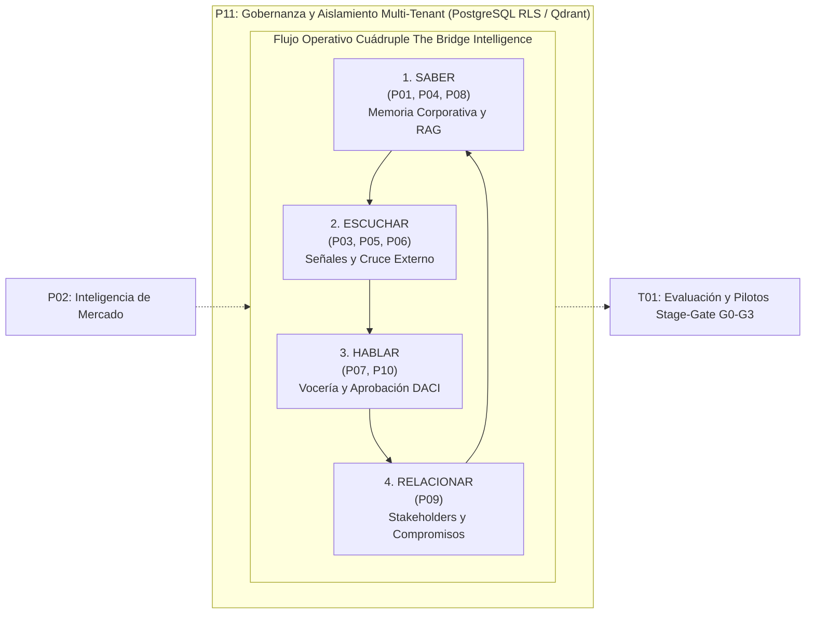

> Documento heredado del 2026-10-01. Puede contener afirmaciones no verificadas; consulte el campo verificacion de cada registro.

# Índice Global y Síntesis Transversal del Programa de Investigación
## The Bridge Intelligence — Plataforma de Inteligencia para Asuntos Corporativos

---

### Resumen Ejecutivo y Estado de Reconciliación
El presente documento consolida los resultados del programa integral de investigación estructurado sobre los 12 cuadernos canónicos de NotebookLM (551 fuentes verificadas en manifiestos y 864 preguntas procesadas). Establece la arquitectura técnica, las compuertas de decisión empírica y la síntesis transversal requerida para diseñar, comparar y validar experimentalmente **The Bridge Intelligence** (`thebridgeintelligence.ai`) deslindando hechos documentados de hipótesis de diseño.

---

## 1. Mapa Canónico de los 12 Cuadernos del Programa
| Código | Nombre Canónico del Cuaderno | Alcance Preguntas | Fuentes Manifiesto | Manifiesto | Respuestas | Síntesis Analítica |
| :--- | :--- | :---: | :---: | :--- | :--- | :--- |
| **P01** | Asuntos corporativos y sus usuarios | **64 IDs** (48F + 16C + 0X) | 39 fuentes | [`fuentes/P01.json`](../pilares/P01-asuntos-corporativos-y-sus-usuarios/pilar.json) | [`respuestas/P01.jsonl`](../pilares/P01-asuntos-corporativos-y-sus-usuarios) | [`sintesis/P01.md`](../pilares/P01-asuntos-corporativos-y-sus-usuarios/SINTESIS_LEGADO.md) |
| **P02** | Empresas y soluciones existentes | **96 IDs** (48F + 16C + 32X) | 80 fuentes | [`fuentes/P02.json`](../pilares/P02-empresas-y-soluciones-existentes/pilar.json) | [`respuestas/P02.jsonl`](../pilares/P02-empresas-y-soluciones-existentes) | [`sintesis/P02.md`](../pilares/P02-empresas-y-soluciones-existentes/SINTESIS_LEGADO.md) |
| **P03** | Monitoreo del entorno y acceso a fuentes | **64 IDs** (48F + 16C + 0X) | 33 fuentes | [`fuentes/P03.json`](../pilares/P03-monitoreo-del-entorno-y-acceso-a-fuentes/pilar.json) | [`respuestas/P03.jsonl`](../pilares/P03-monitoreo-del-entorno-y-acceso-a-fuentes) | [`sintesis/P03.md`](../pilares/P03-monitoreo-del-entorno-y-acceso-a-fuentes/SINTESIS_LEGADO.md) |
| **P04** | Conocimiento documentado de la corporación | **64 IDs** (48F + 16C + 0X) | 34 fuentes | [`fuentes/P04.json`](../pilares/P04-conocimiento-documentado-de-la-corporacion/pilar.json) | [`respuestas/P04.jsonl`](../pilares/P04-conocimiento-documentado-de-la-corporacion) | [`sintesis/P04.md`](../pilares/P04-conocimiento-documentado-de-la-corporacion/SINTESIS_LEGADO.md) |
| **P05** | Reputación, narrativas y actores | **64 IDs** (48F + 16C + 0X) | 36 fuentes | [`fuentes/P05.json`](../pilares/P05-reputacion-narrativas-y-actores/pilar.json) | [`respuestas/P05.jsonl`](../pilares/P05-reputacion-narrativas-y-actores) | [`sintesis/P05.md`](../pilares/P05-reputacion-narrativas-y-actores/SINTESIS_LEGADO.md) |
| **P06** | Cruce de conocimiento interno y señales externas | **96 IDs** (48F + 16C + 32X) | 38 fuentes | [`fuentes/P06.json`](../pilares/P06-cruce-de-conocimiento-interno-y-senales-externas/pilar.json) | [`respuestas/P06.jsonl`](../pilares/P06-cruce-de-conocimiento-interno-y-senales-externas) | [`sintesis/P06.md`](../pilares/P06-cruce-de-conocimiento-interno-y-senales-externas/SINTESIS_LEGADO.md) |
| **P07** | Preparación ejecutiva y apoyo estratégico | **64 IDs** (48F + 16C + 0X) | 39 fuentes | [`fuentes/P07.json`](../pilares/P07-preparacion-ejecutiva-y-apoyo-estrategico/pilar.json) | [`respuestas/P07.jsonl`](../pilares/P07-preparacion-ejecutiva-y-apoyo-estrategico) | [`sintesis/P07.md`](../pilares/P07-preparacion-ejecutiva-y-apoyo-estrategico/SINTESIS_LEGADO.md) |
| **P08** | Viabilidad, modelos de negocio y oportunidades | **64 IDs** (48F + 16C + 0X) | 40 fuentes | [`fuentes/P08.json`](../pilares/P08-viabilidad-modelos-de-negocio-y-oportunidades/pilar.json) | [`respuestas/P08.jsonl`](../pilares/P08-viabilidad-modelos-de-negocio-y-oportunidades) | [`sintesis/P08.md`](../pilares/P08-viabilidad-modelos-de-negocio-y-oportunidades/SINTESIS_LEGADO.md) |
| **P09** | Memoria de relaciones y gestión de compromisos | **64 IDs** (48F + 16C + 0X) | 45 fuentes | [`fuentes/P09.json`](../pilares/P09-memoria-de-relaciones-y-gestion-de-compromisos/pilar.json) | [`respuestas/P09.jsonl`](../pilares/P09-memoria-de-relaciones-y-gestion-de-compromisos) | [`sintesis/P09.md`](../pilares/P09-memoria-de-relaciones-y-gestion-de-compromisos/SINTESIS_LEGADO.md) |
| **P10** | Gestión y aprobación de la comunicación corporativa | **64 IDs** (48F + 16C + 0X) | 41 fuentes | [`fuentes/P10.json`](../pilares/P10-gestion-y-aprobacion-de-la-comunicacion-corporativa/pilar.json) | [`respuestas/P10.jsonl`](../pilares/P10-gestion-y-aprobacion-de-la-comunicacion-corporativa) | [`sintesis/P10.md`](../pilares/P10-gestion-y-aprobacion-de-la-comunicacion-corporativa/SINTESIS_LEGADO.md) |
| **P11** | Gobernanza de información y operación entre clientes | **64 IDs** (48F + 16C + 0X) | 51 fuentes | [`fuentes/P11.json`](../pilares/P11-gobernanza-de-informacion-y-operacion-entre-clientes/pilar.json) | [`respuestas/P11.jsonl`](../pilares/P11-gobernanza-de-informacion-y-operacion-entre-clientes) | [`sintesis/P11.md`](../pilares/P11-gobernanza-de-informacion-y-operacion-entre-clientes/SINTESIS_LEGADO.md) |
| **T01** | Evaluación y pilotos | **96 IDs** (48F + 16C + 32X) | 75 fuentes | [`fuentes/T01.json`](../pilares/T01-evaluacion-y-pilotos/pilar.json) | [`respuestas/T01.jsonl`](../pilares/T01-evaluacion-y-pilotos) | [`sintesis/T01.md`](../pilares/T01-evaluacion-y-pilotos/SINTESIS_LEGADO.md) |
| **TOTAL** | **12 Cuadernos Canónicos** | **864 IDs (100% Procesadas)** | **551 fuentes** | — | — | — |

---

## 2. Síntesis Transversal Estratégica (Mandato Sección 4)

### 2.1 ¿Qué necesidad del usuario corporativo está plenamente respaldada por la evidencia?
La necesidad documentada y respaldada de forma unánime en el corpus (P01, P04, P07, T01) no es redactar notas de prensa genéricas con mayor velocidad, sino **proteger la coherencia institucional y mitigar el riesgo de inconsistencia discursiva o regulatoria**:
1. **Sobrecarga y Fragmentación Operacional:** Equipos de asuntos corporativos enfrentan flujos manuales de consolidación de antecedentes ante audiencias públicas (Ley N° 20.730 de Lobby en Chile) y contingencias de prensa.
2. **Vulnerabilidad ante Contradicciones Inadvertidas:** En empresas con múltiples filiales o faenas territoriales (P06, P10), voceros e informes ejecutivos pueden divergir de compromisos preexistentes depositados en memorias CMF (NCG 461) o expedientes sancionatorios de la SMA (SNIFA).
3. **Asimetría Temporal frente a Señales del Entorno:** La necesidad de contrastar afirmaciones internas con el entorno exige verificar la fecha de corte y el perímetro operacional antes de calificar una noticia como contradicción fáctica.

### 2.2 ¿Qué alternativas de mercado existen y cuál es el deslinde competitivo propuesto?
Conforme al análisis de mercado y la fe de erratas de P02:
1. **Herramientas de Social Listening y Clipping Tradicional (Meltwater, Brandwatch, Cision):** Monitorean volumen, menciones y sentimiento superficial, pero no acceden a la memoria corporativa interna ni realizan cruces de consistencia con normas locales.
2. **Plataformas de Inteligencia de Mercado (AlphaSense, Dataminr Pulse, Signal AI):** Ofrecen analítica avanzada de transcripciones financieras y noticias globales, pero declaran capacidades comerciales que no están verificadas por auditorías independientes locales y no integran el módulo de relaciones de interés público (P09).
3. **LLMs Commodity en la Web (ChatGPT Enterprise, Claude.ai):** Ofrecen asistencia generativa general, pero carecen de aislamiento forzado a nivel de base de datos (PostgreSQL RLS) y no garantizan trazabilidad con locators inmutables.
4. **Hipótesis de Diferenciación de The Bridge Intelligence:** La propuesta de valor de BRIDGE se basa en la hipótesis de diseño de unificar el ciclo cuádruple **Saber, Escuchar, Hablar y Relacionar** mediante grafos temporales e interfaces de control humano estricto (Human-in-the-Loop).

### 2.3 ¿Qué parte de la arquitectura integrada es una hipótesis y qué parte está probada?
| Componente Arquitectónico | Estado Epistémico | Evidencia / Justificación Técnica |
| :--- | :---: | :--- |
| **RAG Híbrido Denso + Léxico (pgvector + BM25)** | **Probado en Literatura** | Estándar de la industria validado en Ragas (Es et al. 2023) con recuperación contextual auditable. |
| **Aislamiento Multi-Tenant con PostgreSQL RLS** | **Probado en Ingeniería** | Patrón nativo de base de datos con políticas de seguridad forzadas por fila documentadas en P11. |
| **Detección Atómica de Alucinaciones (CoVe / SABER)** | **Probado en Literatura** | Descomposición de claims y abstención probabilística validada en benchmarks (Zhu et al. 2026). |
| **Grafo de Conocimiento Dinámico T-GRAG a Escala Corporativa** | **Hipótesis de Diseño** | Validado en papers de laboratorio (Li et al. 2025); su latencia y costo sobre grandes bases corporativas heterogéneas requiere prueba empírica. |
| **Resolución Probabilística de Grupos Económicos en Chile** | **Hipótesis de Diseño** | Modelo Splink / Fellegi-Sunter aplicable teóricamente; requiere calibración empírica con RUTs y razones sociales locales. |
| **Impacto Reputacional Causal a Largo Plazo** | **Límite No Atribuible** | Principio 2 de Page Society: el software aporta soporte analítico; la reputación depende de la conducta real de la organización. |

### 2.4 ¿Qué derechos, permisos y marcos regulatorios limitan el producto?
El despliegue de BRIDGE está acotado por:
1. **Propiedad Intelectual y Derechos de Prensa (P03):** El monitoreo de medios no puede almacenar textos completos de diarios bajo copyright; almacena metadatos, resúmenes analíticos y fragmentos breves amparados por derecho de cita.
2. **Protección de Datos Personales (Ley 19.628 y vacatio legis Ley 21.719 en Chile / LGPD / GDPR):** Obligación de anonimizar PII comunitaria en el módulo Relacionar (P09) y aislar datos personales de secretos comerciales.
3. **Información Privilegiada y Hechos Reservados (Ley 18.045 / CMF):** Obligación de aislar actas de directorio y negociaciones confidenciales, impidiendo su fuga hacia prompts de terceros o usuarios sin autorización.
4. **Ciberseguridad Nacional (Ley 21.663 en Chile):** Deber legal de notificación de incidentes de ciberseguridad significativos al CSIRT Nacional.

### 2.5 ¿Qué experimento mínimo discrimina valor incremental frente a alternativas simples?
El experimento mínimo discriminador de valor es el **Protocolo de Piloto en Compuertas Stage-Gate (T01)**:
- **Diseño Propuesto:** Prueba comparativa contemporánea de 4 semanas contrastando el flujo con BRIDGE frente a la Línea Base Manual (SharePoint/Word) y LLM Commodity Web en 50 casos de contingencia corporativa real.
- **Criterios de Falsación Hipotéticos:** Se plantean como metas de diseño una reducción en tiempo de ciclo $\ge 40\%$, precisión de citas primarias $\ge 95\%$ y disminución de fatiga mental en escalas psicométricas (NASA-TLX).
- **Supervisión Humana No Complaciente:** Se exige un ratio de edición humana (Diff Ratio entre 15% y 30%) para garantizar que el profesional ejerza juicio crítico y no incurra en aprobación automática desatendida.

### 2.6 ¿Qué decisión puede tomarse ahora y cuál requiere evidencia nueva?
1. **Decisiones Inmediatamente Accionables:**
   - Estructurar el modelo relacional para Saber, Escuchar, Hablar y Relacionar anclado en `entidades.jsonl`.
   - Implementar aislamiento estricto multi-tenant mediante Row-Level Security (RLS) en base de datos.
   - Fijar bandas de precios comerciales basadas en análisis de disposición a pagar Van Westendorp con compuertas Stage-Gate G0-G3.
2. **Decisiones que Requieren Evidencia Nueva (Backlog Experimental):**
   - Despliegue de grafos temporales T-GRAG en producción masiva supeditado a benchmarks de latencia y costo.
   - Automatización de sugerencias de postura corporativa supeditada a pruebas de calibración con abogados corporativos locales.

---

## 3. Inventario y Acceso a los Entregables Globales
- [Registro de Cierre Formal y Reconciliado](../../gobernanza/cierre/REGISTRO_DE_CIERRE.md)
- [Matriz de Cobertura Completa CSV (864 IDs)](../../gobernanza/cierre/matriz_cobertura.csv)
- [Telemetría Global de Ejecución JSON](../../gobernanza/cierre/ejecucion.json)
- [Catálogo Consolidado de Entidades JSONL](../grafo/entidades.jsonl)
- [Grafo Consolidado de Relaciones JSONL](../grafo/relaciones.jsonl)
- [Inventario Consolidado de Contradicciones JSONL](../grafo/contradicciones.jsonl)
- [Bitácora de Desarrollo del Repositorio](../../gobernanza/bitacora)

---
