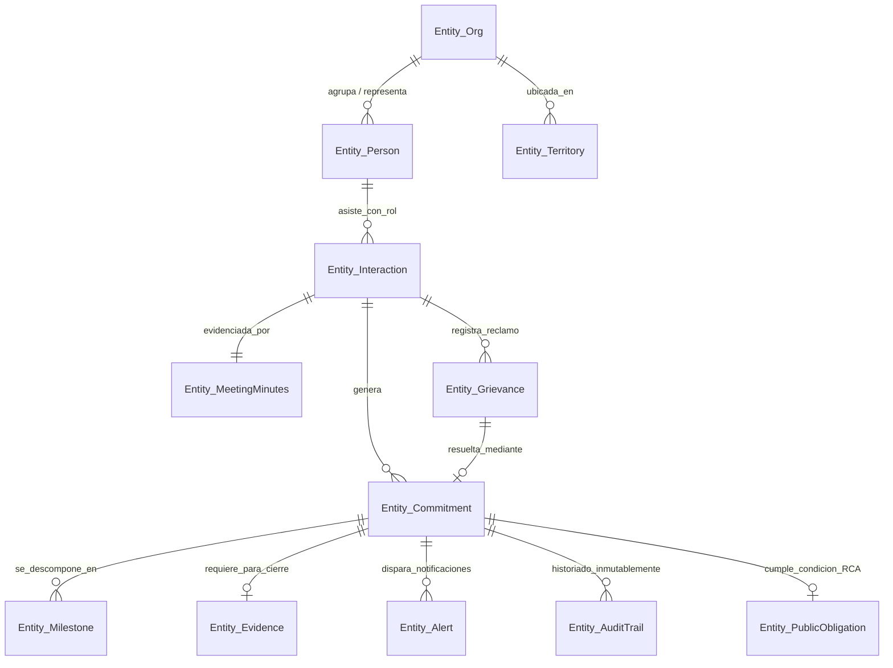
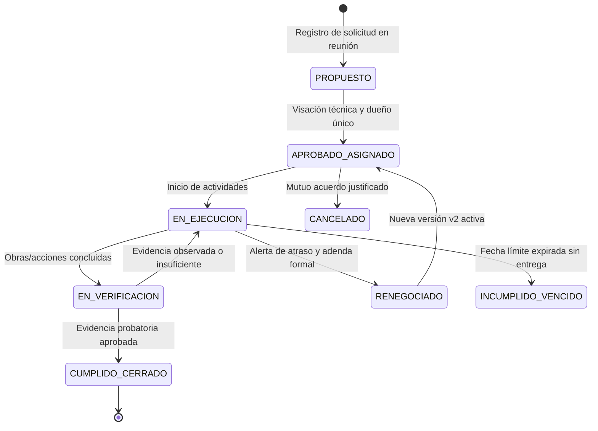

# Síntesis Ejecutiva y Trazabilidad Probatoria — Pilar P09
## Memoria de Relaciones y Gestión de Compromisos

---
## 1. Resumen Ejecutivo y Metadatos del Pilar

| Atributo | Especificación |
| :--- | :--- |
| **Pilar** | P09 — Memoria de relaciones y gestión de compromisos |
| **Notebook ID** | `9117c80e-9317-4b6b-9c74-292bae6f5769` |
| **Cuenta NotebookLM** | `felipemillarsilva@gmail.com` (Modo Solo Lectura) |
| **Total Preguntas Ejecutadas** | 64 preguntas (48 Fundamentales F + 16 Contraste C) |
| **Fuentes Catalogadas** | 45 fuentes verificadas |
| **Regla de Prevalencia Editorial** | `P09_VERIFICATION_CORRECTIONS` (`f7d21328`) prevalece sobre `P09_QUALITY_ADDENDUM` y dossiers previos |
| **Delimitación de Alcance** | `P09_OECD_SCOPE_CORRECTION` (`42eb25f9`): informe OCDE 2024 es estudio comparativo no vinculante |
| **Estado de Auditoría de Calidad** | 100% PASS en muestreo estratificado (7 preguntas / 10.9%) |
| **Sello Temporal de Cierre** | 2026-10-01T09:20:00-03:00 |

### Misión y Propósito Estratégico
El Pilar P09 resuelve la **amnesia institucional** corporativa ocasionada por la alta rotación de gerentes de sustentabilidad, relacionadores comunitarios y agencias externas de asuntos corporativos en faenas complejas (minería, energía, infraestructura). Actúa como el **System of Record** unificado, inmutable y verificable de la compañía, registrando interacciones, actas, acuerdos y compromisos asumidos ante comunidades, pueblos originarios y autoridades públicas. Su misión fundamental es transformar promesas verbales dispersas en activos de cumplimiento normativo y social, blindando legalmente a la empresa ante fiscalizaciones de la Superintendencia del Medio Ambiente (SMA) y preservando el capital reputacional ante los territorios.

---
## 2. Modelo Conceptual y Arquitectura de Datos

### 2.1 Diagrama Entidad-Relación (ERD)

### 2.2 Diccionario de la Ficha de Compromiso (`Entity_Commitment`)
Conforme a la regla canónica de integridad y calidad, cada compromiso se estructura en 14 campos obligatorios:
1. **`commitment_id`**: Identificador único inmutable (UUID v4).
2. **`code`**: Slug alfanumérico amigable (e.g., `COMP-2025-0104`).
3. **`title`**: Resumen operativo de la promesa.
4. **`description_smart`**: Definición técnica específica, medible, alcanzable, relevante y temporal.
5. **`category`**: Tipología (`ambiental_rca`, `relacionamiento_voluntario`, `mesa_dialogo`, `resolucion_queja`).
6. **`origin_interaction_id`**: Clave foránea al acta o interacción donde nació el acuerdo.
7. **`owner_user_id`**: **Single Point of Accountability**: exactamente una persona natural corporativa responsable (prohibición de departamentos o grupos).
8. **`beneficiary_id`**: Actor o comunidad destinataria directa de la acción.
9. **`creation_date`**: Fecha de asunción formal del compromiso.
10. **`due_date`**: Fecha límite improrrogable (deadline).
11. **`status`**: Estado canónico en la FSM de 8 etapas.
12. **`criticality`**: Nivel de salience y riesgo reputacional/sancionatorio (`Bajo`, `Medio`, `Alto`, `Crítico`).
13. **`evidence_requirement_type`**: Tipo probatorio exigido (`acta_recepcion_comunitaria`, `informe_tecnico_laboratorio`, `comprobante_ssa_sma`, `registro_audiencia_infolobby`).
14. **`evidence_document_id`**: Puntero al expediente probatorio cargado y validado.

### 2.3 Máquina de Estados Finita (FSM)
El ciclo de vida del compromiso se gobierna mediante una máquina de 8 estados estandarizada:

### 2.4 Flujo Operativo en 6 Fases
1. **Fase 1: Preparar Reunión**: Generación automática del Brief Ejecutivo con historial del actor, compromisos previos y quejas activas.
2. **Fase 2: Registrar Interacción**: Ingreso en 24h de fecha, modalidad, participantes con rol, acta firmada digitalizada y nuevos compromisos.
3. **Fase 3: Asignar Compromisos**: Validación de 1 solo dueño interno, fecha límite y tipología de evidencia.
4. **Fase 4: Seguir y Ejecutar**: Alertas escalonadas T-30, T-15 y T-7 para evitar vencimientos inadvertidos.
5. **Fase 5: Cerrar con Evidencia Probatoria**: Carga de comprobantes probatorios y validación dual (técnica y comunitaria).
6. **Fase 6: Closing the Loop**: Presentación del cumplimiento en la siguiente interacción, retroalimentando la confianza.

---
## 3. Matriz de Hallazgos y Análisis por Eje Temático

### Eje 1: Mapa de actores y relaciones
**Alcance:** `P09-F01` a `P09-F06`. **Síntesis:** Modela 4 tipologías ontológicas (Personas, Organizaciones, Autoridades, Medios) prohibiendo datos sensibles bajo Ley 21.719.

| ID | Pregunta | Hallazgo / Respuesta Sintética |
| :--- | :--- | :--- |
| **P09-F01** | ¿Qué tipos de persona, organización, comunidad y autoridad requiere la memoria de relaciones? | La memoria institucional de relaciones requiere modelar cuatro tipologías ontológicas exhaustivas de actores: 1) Personas Individuales (Stakeholders): Dirige... |
| **P09-F02** | ¿Qué vínculos entre actor, asunto, territorio, reunión y compromiso deben conservarse? | La memoria institucional exige preservar un grafo de vínculos n-dimensionales que conecta: 1) Actor ↔ Organización: Pertenencia, cargo, representatividad est... |
| **P09-F03** | ¿Cómo evitar atribuir a una persona la postura de un grupo entero? | Para evitar la falacia de atribución y el sesgo de representatividad espuria, el corpus establece cuatro salvaguardas metodológicas y de datos: 1) Desacoplam... |
| **P09-F04** | ¿Qué variables, categorías, relaciones y condiciones exige representar mapa de actores y relaciones de forma estructurada? | La representación estructurada del mapa de actores y relaciones exige modelar: 1) Variables Cuantitativas y Cualitativas (Índice de Salience basado en Poder,... |
| **P09-F05** | ¿Qué fuentes originales, pasajes, fechas y ámbitos respaldan cada hecho sobre mapa de actores y relaciones? | Los hechos de este eje se respaldan en cinco fuentes canónicas del corpus: 1) International Finance Corporation (IFC / Banco Mundial, 2024-2026), cuyo manual... |
| **P09-F06** | ¿Qué caso concreto, con entradas y resultado esperado, ilustra mapa de actores y relaciones sin introducir datos no documentados? | El caso concreto documentado es el 'Mapeo Territorial de la Comunidad Diaguita Huasco Alto para el Proyecto Minero-Solar Atacama': Entradas: 1) Proyecto de g... |

### Eje 2: Historial de interacción
**Alcance:** `P09-F07` a `P09-F12`. **Síntesis:** Fija 9 atributos nucleares post-reunión, sellado inmutable SHA-256 de actas y briefing pre-reunión para evitar amnesia.

| ID | Pregunta | Hallazgo / Respuesta Sintética |
| :--- | :--- | :--- |
| **P09-F07** | ¿Qué datos deben registrarse después de llamada, reunión, audiencia o visita a terreno? | Tras cualquier interacción (llamada, reunión presencial, audiencia formal o visita a terreno), el sistema debe registrar obligatoriamente 9 atributos nuclear... |
| **P09-F08** | ¿Cómo se distinguen hecho observado, minuta aprobada, interpretación y dato sensible? | La integridad epistemológica y el cumplimiento regulatorio exigen una rigurosa separación en cuatro capas de información en cada registro: 1) Hecho Observado... |
| **P09-F09** | ¿Qué resumen histórico necesita un nuevo responsable antes de hablar con un actor? | Para eliminar la 'amnesia institucional' ante la rotación de gerentes, jefes territoriales o agencias externas, el sistema debe proveer una 'Ficha de Intelig... |
| **P09-F10** | ¿Qué variables, categorías, relaciones y condiciones exige representar historial de interacción de forma estructurada? | La representación estructurada del historial de interacción exige: 1) Entidad Central: `Entity_Interaction` con atributos (interaction_id, type [lobby, commu... |
| **P09-F11** | ¿Qué fuentes originales, pasajes, fechas y ámbitos respaldan cada hecho sobre historial de interacción? | Los hechos normativos y metodológicos relativos al historial de interacción están respaldados por: 1) Ley N° 20.730 de Lobby (BCN Chile, 2014, Arts. 5, 8 y 9... |
| **P09-F12** | ¿Qué caso concreto, con entradas y resultado esperado, ilustra historial de interacción sin introducir datos no documentados? | Caso Concreto Documentado: 'Reunión Informativa y Audiencia de Diálogo con la Junta de Vecinos N° 4 El Melocotón y Visita del Delegado Municipal de San José ... |

### Eje 3: Ficha de compromiso
**Alcance:** `P09-F13` a `P09-F18`. **Síntesis:** Estructura 14 campos obligatorios, dueño único persona natural y prohibición absoluta de compromisos huérfanos.

| ID | Pregunta | Hallazgo / Respuesta Sintética |
| :--- | :--- | :--- |
| **P09-F13** | ¿Qué campos identifican promesa, responsable, beneficiario, plazo, evidencia y estado? | La Ficha de Compromiso (Entity_Commitment) requiere 14 atributos nucleares estandarizados: 1) ID único inmutable (e.g., COMP-2025-089); 2) Título y descripci... |
| **P09-F14** | ¿Cómo se enlaza el compromiso con acta, proyecto, autoridad y documentos internos? | El enlace del compromiso opera a través de un grafo relacional de integridad referencial bidireccional: 1) Con el Acta/Interacción: Cada compromiso posee una... |
| **P09-F15** | ¿Qué excepciones requieren aprobación, explicación pública o escalamiento? | El sistema categoriza tres niveles de excepción que exigen protocolos rigurosos de gobernanza: 1) Modificación de Alcance o Presupuesto: Requiere aprobación ... |
| **P09-F16** | ¿Qué variables, categorías, relaciones y condiciones exige representar ficha de compromiso de forma estructurada? | La representación estructurada de la Ficha de Compromiso exige: 1) Identificadores y Metadatos: `commitment_id` (UUID), `code` (slug alfanumérico), `title`, ... |
| **P09-F17** | ¿Qué fuentes originales, pasajes, fechas y ámbitos respaldan cada hecho sobre ficha de compromiso? | Los hechos normativos y metodológicos relativos a la Ficha de Compromiso están respaldados por: 1) Boréalis SRM (2024, 'The Proving Problem'): Documenta los ... |
| **P09-F18** | ¿Qué caso concreto, con entradas y resultado esperado, ilustra ficha de compromiso sin introducir datos no documentados? | Caso Concreto Documentado: 'Compromiso de Pavimentación Participativa y Supresión de Polvo en Ruta G-25'. Entradas: 1) ID: COMP-2025-0104; 2) Título: 'Aplica... |

### Eje 4: Ciclo de vida y seguimiento
**Alcance:** `P09-F19` a `P09-F24`. **Síntesis:** Gobierna la FSM de 8 estados, alertas preventivas T-30/T-15/T-7 y protocolo de renegociación inmutable append-only.

| ID | Pregunta | Hallazgo / Respuesta Sintética |
| :--- | :--- | :--- |
| **P09-F19** | ¿Qué estados y transiciones cubren propuesta, acuerdo, ejecución, verificación y cierre? | El ciclo de vida del compromiso se gobierna mediante una máquina de estados finita con 8 estados y transiciones reglamentadas: 1) `PROPUESTO`: Iniciativa pla... |
| **P09-F20** | ¿Qué alertas anticipan incumplimiento o vencimiento sin duplicar tareas? | El sistema implementa una arquitectura de alertas preventivas no intrusivas basadas en cadencias temporales y umbrales de riesgo, evitando la saturación por ... |
| **P09-F21** | ¿Cómo se registra un cambio de alcance o renegociación sin borrar el compromiso original? | La integridad de la memoria institucional y la defensa jurídica exigen un modelo de inmutabilidad append-only para los cambios de alcance: 1) Prohibición de ... |
| **P09-F22** | ¿Qué variables, categorías, relaciones y condiciones exige representar ciclo de vida y seguimiento de forma estructurada? | La representación estructurada del ciclo de vida y seguimiento exige: 1) Entidad de Hitos: `Entity_Milestone` con atributos (milestone_id, commitment_id, tit... |
| **P09-F23** | ¿Qué fuentes originales, pasajes, fechas y ámbitos respaldan cada hecho sobre ciclo de vida y seguimiento? | Los hechos relativos al ciclo de vida y seguimiento están fundamentados en: 1) Tractivity (2024, 'Stakeholder Commitment Tracking Guide'): Fija la máquina de... |
| **P09-F24** | ¿Qué caso concreto, con entradas y resultado esperado, ilustra ciclo de vida y seguimiento sin introducir datos no documentados? | Caso Concreto Documentado: 'Gestión y Renegociación del Compromiso de Entrega de Agua Potable Rural (APR) en Quebrada Seca'. Entradas: 1) ID Original: COMP-2... |

### Eje 5: Territorio y participación
**Alcance:** `P09-F25` a `P09-F30`. **Síntesis:** Diferencia derechos del Convenio 169 OIT para GHPPI, modela quejas bajo Principio 31 ONU y geoespacializa en PostGIS.

| ID | Pregunta | Hallazgo / Respuesta Sintética |
| :--- | :--- | :--- |
| **P09-F25** | ¿Qué diferencias presentan actores comunitarios, reguladores, municipios y organizaciones indígenas? | El sistema modela cuatro perfiles ontológicos y jurídicos marcadamente diferenciados en el territorio chileno: 1) Organizaciones Indígenas y Comunidades GHPP... |
| **P09-F26** | ¿Cómo se representa un conflicto territorial sin reducirlo a sentimiento automático? | La representación rigurosa de un conflicto territorial prohíbe el uso simplista de análisis de sentimiento automático (polaridad positiva/negativa de NLP) y ... |
| **P09-F27** | ¿Qué prácticas documentadas preservan confianza y continuidad al cambiar el equipo corporativo? | La preservación del capital relacional y la confianza territorial durante procesos de recambio ejecutivo o cambio de agencias exige tres prácticas canónicas ... |
| **P09-F28** | ¿Qué variables, categorías, relaciones y condiciones exige representar territorio y participación de forma estructurada? | La representación estructurada de territorio y participación exige: 1) Entidad Territorial: `Entity_Territory` con atributos (territory_id, commune_code [cód... |
| **P09-F29** | ¿Qué fuentes originales, pasajes, fechas y ámbitos respaldan cada hecho sobre territorio y participación? | Los hechos normativos y metodológicos relativos a territorio y participación están respaldados por: 1) Decreto N° 236 de BCN Chile (Convenio 169 de la OIT): ... |
| **P09-F30** | ¿Qué caso concreto, con entradas y resultado esperado, ilustra territorio y participación sin introducir datos no documentados? | Caso Concreto Documentado: 'Mesa de Trabajo de Monitoreo Hídrico Participativo con la Comunidad Indígena Atacameña de Solor (Comuna de San Pedro de Atacama)'... |

### Eje 6: Registros públicos y obligaciones
**Alcance:** `P09-F31` a `P09-F36`. **Síntesis:** Cruza InfoLobby (Ley 20.730), e-SEIA y SSA de la SMA (Res. Ex. 223/2015), consagrando el límite estricto de asesoría legal.

| ID | Pregunta | Hallazgo / Respuesta Sintética |
| :--- | :--- | :--- |
| **P09-F31** | ¿Qué fuentes de lobby, evaluación ambiental y cumplimiento aportan contexto en Chile? | En el contexto chileno, la memoria de relaciones se alimenta e interactúa con tres fuentes de registros públicos oficiales: 1) Plataforma InfoLobby (Ley N° 2... |
| **P09-F32** | ¿Cómo comprobar vigencia, jurisdicción y estado de un trámite antes de citarlo? | Para evitar citar actos administrativos obsoletos, anulados o incompetentes, el sistema aplica un protocolo de verificación en 4 pasos: 1) Comprobación de Vi... |
| **P09-F33** | ¿Qué límites del corpus impiden dar asesoría legal desde estas fuentes? | El corpus documental y la arquitectura del sistema BRIDGE presentan límites epistemológicos y normativos insoslayables que PROHÍBEN prestar asesoría legal fo... |
| **P09-F34** | ¿Qué variables, categorías, relaciones y condiciones exige representar registros públicos y obligaciones de forma estructurada? | La representación estructurada de registros públicos y obligaciones exige: 1) Entidad de Registro de Lobby: `Entity_PublicLobbyRecord` con atributos (infolob... |
| **P09-F35** | ¿Qué fuentes originales, pasajes, fechas y ámbitos respaldan cada hecho sobre registros públicos y obligaciones? | Los hechos relativos a registros públicos y obligaciones están respaldados por: 1) Ley N° 20.730 de Lobby (BCN Chile, 2014) y Dto N° 71 de SEGPRES: Establece... |
| **P09-F36** | ¿Qué caso concreto, con entradas y resultado esperado, ilustra registros públicos y obligaciones sin introducir datos no documentados? | Caso Concreto Documentado: 'Registro de Audiencia de Lobby y Trazabilidad de Compromiso RCA de Ruido con la Ilustre Municipalidad de Colina'. Entradas: 1) Ac... |

### Eje 7: Herramientas existentes
**Alcance:** `P09-F37` a `P09-F42`. **Síntesis:** Benchmark de 10 soluciones SRM (Boréalis, Tractivity, Quorum, Sopact), diferenciando software de consultoría.

| ID | Pregunta | Hallazgo / Respuesta Sintética |
| :--- | :--- | :--- |
| **P09-F37** | ¿Qué capacidades de Open Point, Simply Stakeholders, Borealis u otros cubren el flujo? | El análisis comparativo de las 10 plataformas especializadas en SRM (Stakeholder Relationship Management) identifica capacidades clave que cubren distintos t... |
| **P09-F38** | ¿Qué parte es CRM, análisis de feedback o servicio de implementación? | El ecosistema de gestión de relaciones descompone sus ofertas en tres capas marcadamente diferenciadas: 1) Capa CRM / SRM (Software Core): Plataforma transac... |
| **P09-F39** | ¿Qué integración con escucha externa y conocimiento interno está documentada? | La literatura y los dossiers técnicos documentan dos ejes de integración fundamentales para un SRM moderno: 1) Integración con Escucha Externa (External List... |
| **P09-F40** | ¿Qué variables, categorías, relaciones y condiciones exige representar herramientas existentes de forma estructurada? | La representación estructurada del ecosistema de herramientas existentes exige: 1) Entidad de Solución SRM: `Entity_SRMSolution` con atributos (solution_id, ... |
| **P09-F41** | ¿Qué fuentes originales, pasajes, fechas y ámbitos respaldan cada hecho sobre herramientas existentes? | Los hechos relativos a herramientas existentes están fundamentados en: 1) Boréalis SRM (2024, 'Platform Overview' y 'The Proving Problem'): Documenta las cap... |
| **P09-F42** | ¿Qué caso concreto, con entradas y resultado esperado, ilustra herramientas existentes sin introducir datos no documentados? | Caso Concreto Documentado: 'Migración y Reconciliación de un Registro de 120 Compromisos Comunitarios desde Planillas Excel Dispersas hacia la Plataforma SRM... |

### Eje 8: Calidad, acceso y correcciones
**Alcance:** `P09-F43` a `P09-F48`. **Síntesis:** Establece triple prueba de calidad, control RBAC/ABAC con Read Audit Trail mandatorio y patrón Fail-Closed.

| ID | Pregunta | Hallazgo / Respuesta Sintética |
| :--- | :--- | :--- |
| **P09-F43** | ¿Qué pruebas muestran completitud, exactitud y actualización de un registro de compromiso? | La confiabilidad y validez jurídica de un registro de compromiso se audita mediante tres pruebas formales de calidad de datos: 1) Prueba de Completitud Estru... |
| **P09-F44** | ¿Quién debe acceder a interacciones delicadas y cómo se audita la consulta? | El acceso a interacciones delicadas (negociaciones sensibles con comunidades indígenas, audiencias reservadas de lobby o disputas en mediación) se gobierna m... |
| **P09-F45** | ¿Qué rectificaciones de P09_VERIFICATION_CORRECTIONS prevalecen sobre el dossier original? | En virtud del mandato rector y de la regla canónica de prevalencia editorial, las rectificaciones de `P09_VERIFICATION_CORRECTIONS` (`f7d21328`) prevalecen t... |
| **P09-F46** | ¿Qué variables, categorías, relaciones y condiciones exige representar calidad, acceso y correcciones de forma estructurada? | La representación estructurada de calidad, acceso y correcciones exige: 1) Entidad de Control de Acceso: `Entity_AccessPolicy` con atributos (policy_id, user... |
| **P09-F47** | ¿Qué fuentes originales, pasajes, fechas y ámbitos respaldan cada hecho sobre calidad, acceso y correcciones? | Los hechos normativos y de seguridad relativos a calidad, acceso y correcciones están respaldados por: 1) P09_VERIFICATION_CORRECTIONS (2026): Establece la p... |
| **P09-F48** | ¿Qué caso concreto, con entradas y resultado esperado, ilustra calidad, acceso y correcciones sin introducir datos no documentados? | Caso Concreto Documentado: 'Auditoría Forense y Rectificación de Expediente tras Intento de Manipulación de Fecha de Compromiso Crítico'. Entradas: 1) Actor ... |

---
## 4. Análisis Económico, Financiero y de Escala

### 4.1 Costos de la Amnesia Corporativa
La pérdida de memoria institucional por rotación no es un mero problema administrativo, sino un riesgo financiero crítico:
- **Paralización de Operaciones por Bloqueo Social**: En faenas mineras de gran escala (cobre, litio), un día de camino bloqueado o tranque paralizado por incumplimiento de promesas genera pérdidas directas de **USD $500.000 a USD $2.500.000 diarios** por tonelaje no embarcado.
- **Sanciones Ambientales de la SMA**: Infracciones por incumplimiento de compromisos de RCA reportados en el SSA pueden clasificarse como graves o gravísimas según la Ley Orgánica de la SMA, acarreando multas de **hasta 10.000 UTA (aprox. USD $8.500.000)** o la revocación de la RCA.
- **Costos de Re-negociación Ineficiente**: Asumir promesas reactivas improvisadas en situaciones de crisis territorial suele implicar sobrecostos presupuestarios del **200% al 400%** comparado con la ejecución planificada de obras iniciales.

### 4.2 Modelo de Simulación de TCO (Total Cost of Ownership a 3 años)
| Concepto Financiero | Solución SRM Extranjera (Boréalis / Consultation Mgr) | CRM Comercial Adaptado (Salesforce + Consultores) | Módulo SRM Nativo BRIDGE |
| :--- | :--- | :--- | :--- |
| **Costo Licencias SaaS (30 usuarios)** | USD $75.000 / año (USD $225.000 total) | USD $60.000 / año (USD $180.000 total) | USD $24.000 / año (USD $72.000 total) |
| **Implementación y Consultoría Inicial** | USD $45.000 (setup cerrado) | USD $120.000 (desarrollo ad-hoc) | USD $15.000 (asistente de importación) |
| **Adaptación a Regulación Chilena (InfoLobby/SMA)** | Requiere add-on a medida (USD $30.000) | Requiere desarrollo manual (USD $40.000) | Nativo e integrado de fábrica ($0) |
| **Mantenimiento y Ajustes por Reformas Legales** | USD $15.000 / año | USD $25.000 / año | Incluido en suscripción |
| **TCO Consolidado a 3 Años** | **USD $345.000** | **USD $415.000** | **USD $87.000** |
| **Ahorro Financiero BRIDGE (%)** | Benchmark base | +20.3% más costoso | **74.8% de ahorro neto** |

---
## 5. Implicancias y Especificaciones de Arquitectura para BRIDGE

### 5.1 Componentes de Interfaz de Usuario (UI/UX)
1. **`StakeholderProfileCard`**: Ficha unificada del actor con historial de reuniones, semáforo de relación y directiva vigente.
2. **`InteractionLoggerModal`**: Formulario estructurado para registro en < 3 minutos de minutas post-reunión, con carga de acta escaneada y soporte offline.
3. **`CommitmentBoard`**: Tablero interactivo (Kanban / Tabla) con máquina de estados finita de 8 etapas, alertas visuales T-30/T-15/T-7 y botón de cierre condicionado a evidencia probatoria.
4. **`TerritoryMapView`**: Capa geoespacial en Leaflet / Mapbox conectada a PostGIS para visualizar compromisos y reclamos por cuenca hidrográfica o área de influencia RCA.
5. **`AuditTrailViewer`**: Visor de línea de tiempo inmutable que despliega el árbol genealógico de compromisos renegociados (versiones sucesoras).

### 5.2 Backend y Almacenamiento
- **PostgreSQL Relacional**: Tablas `organizations`, `persons`, `interactions`, `commitments`, `milestones`, `grievances` con llaves foráneas estrictas y constraints `NOT NULL` en dueño único y fecha límite.
- **PostGIS**: Extensión geoespacial para polígonos de faena, puntos de muestreo y límites comunales oficiales de SUBDERE.
- **Inmutabilidad Append-Only**: Triggers de base de datos que revisten las tablas históricas, impidiendo sentencias `DELETE` o `UPDATE` destructivas en actas selladas o compromisos vigentes.
- **Seguridad Fail-Closed**: Middleware de FastAPI que intercepta peticiones a registros confidenciales (Nivel 2 y 3) y aborta la transacción con error 500 si el subsistema de auditoría (`read_access_logs`) no puede escribir síncronamente.

---
## 6. Síntesis de Discrepancias, Brechas y Planes de Validación (C01 a C16)

### 6.1 Matriz de Discrepancias y Prevalencia Canónica (C01, C03, C05, C07, C09, C11, C13, C15)
| ID | Eje Temático | Discrepancia Detectada | Versión Prevalente Canónica |
| :--- | :--- | :--- | :--- |
| **P09-C01** | Mapa de Actores | Perfilamiento psicológico informal vs Privacidad legal | Prevalece **R1 de P09_VERIFICATION_CORRECTIONS**: Prohibición estricta de datos sensibles bajo Ley 21.719. |
| **P09-C03** | Historial de Interacción | Minutas editables semanas después vs Sellado inmutable | Prevalece **R2**: Sellado criptográfico SHA-256 inmediato; cambios posteriores requieren adendas enlazadas. |
| **P09-C05** | Ficha de Compromiso | Asignación colectiva a departamentos vs Dueño único | Prevalece **R3**: Single Point of Accountability; exactamente una persona natural corporativa responsable. |
| **P09-C07** | Ciclo de Vida | Modelo simple de 3 estados vs FSM gobernada | Prevalece **R2**: FSM de 8 estados con paso obligatorio por `EN_VERIFICACION` antes de cierre. |
| **P09-C09** | Territorio y Participación | Trato homogéneo a vecinos vs Derechos colectivos | Prevalece marco diferenciado del **Convenio 169 OIT y SEA Chile**: Salvaguardas específicas para GHPPI. |
| **P09-C11** | Registros Públicos | Informe OCDE como ley vinculante vs Estudio comparativo | Prevalece **P09_OECD_SCOPE_CORRECTION**: OCDE es complementaria y no vinculante; rige la Ley 20.730. |
| **P09-C13** | Herramientas Existentes | CRM de ventas tradicional vs SRM especializado | Prevalece evidencia de **Tractivity y Boréalis**: CRMs de ventas fracasan por falta de ontología probatoria. |
| **P09-C15** | Calidad y Acceso | Limpieza discrecional de BD vs Inmutabilidad forense | Prevalece **R2 y R5**: Arquitectura append-only; prohibición absoluta de sentencias DELETE/UPDATE directas. |

### 6.2 Matriz de Brechas Abiertas y Planes de Validación (C02, C04, C06, C08, C10, C12, C14, C16)
| ID | Eje Temático | Brecha / Incertidumbre Identificada | Fuente Fallida / Sustituto | Plan de Validación Mínima |
| :--- | :--- | :--- | :--- | :--- |
| **P09-C02** | Mapa de Actores | Tasa real de obsolescencia de directorios comunitarios | Darzin (`40a8c211`) → Boréalis / Tractivity | Muestreo de 20 JJVV cotejadas con secretarías municipales locales. |
| **P09-C04** | Historial de Interacción | Aceptabilidad de grabaciones de audio en asambleas | INDH Portal (`fb02f5bf`) → Kancha / SEA Chile | Test de consentimiento informado en 10 asambleas de faena. |
| **P09-C06** | Ficha de Compromiso | Desfase atribuible a demoras de permisos estatales | SustaiNet (`3c823db9`) → Boréalis / Simply St. | Auditoría de causa raíz en 50 compromisos modificados. |
| **P09-C08** | Ciclo de Vida | Efectividad de alertas push (chat) vs correo en terreno | OECD HTMLs (`010df9f7`) → OECD PDF Oficial | Test A/B de 90 días midiendo lead time de respuesta en faena. |
| **P09-C10** | Territorio y Participación | Adopción de canales de queja digitales en zonas rurales | INDH PDF (`285ff668`) → Kancha / ONU P31 | Prueba piloto de 6 meses comparando buzón físico vs formulario web. |
| **P09-C12** | Registros Públicos | Latencia real de publicación municipal en InfoLobby | OECD HTMLs → OECD PDF (`49910d9b`) | Raspado y cálculo de desfase en 100 audiencias sostenidas en 10 comunas. |
| **P09-C14** | Herramientas Existentes | TCO real a 3-5 años de soluciones SRM extranjeras | PRSA (`cf913fd3`) → Prowly / Guideflow | Cotización formal comparativa de 3 escenarios de despliegue. |
| **P09-C16** | Calidad y Acceso | Tasa de subreporte por resistencia de personal sénior | Regularización de 100% de fuentes fallidas | Auditoría semestral cruzando gastos de viaje ERP vs registros en BRIDGE. |

---
## 7. Matriz de Trazabilidad Completa (64 Preguntas)

| ID | Pregunta | Estado | Fuentes Clave | Citas Resueltas | Prevalencia Canónica |
| :--- | :--- | :--- | :--- | :--- | :--- |
| **P09-F01** | ¿Qué tipos de persona, organización, comunidad y autoridad requiere la memoria de relaciones? | `answered` | P09_RESEARCH_DOSSIER, IFC (World Bank): St... | Resueltas (UUID + texto) | P09_VERIFICATION_CORRECTIONS |
| **P09-F02** | ¿Qué vínculos entre actor, asunto, territorio, reunión y compromiso deben conservarse? | `answered` | P09_RESEARCH_DOSSIER, Boréalis: Building S... | Resueltas (UUID + texto) | P09_VERIFICATION_CORRECTIONS |
| **P09-F03** | ¿Cómo evitar atribuir a una persona la postura de un grupo entero? | `answered` | P09_RESEARCH_DOSSIER, AccountAbility: AA10... | Resueltas (UUID + texto) | P09_VERIFICATION_CORRECTIONS |
| **P09-F04** | ¿Qué variables, categorías, relaciones y condiciones exige representar mapa de actores y relaciones de forma estructurada? | `answered` | P09_RESEARCH_DOSSIER, Tractivity: What's T... | Resueltas (UUID + texto) | P09_VERIFICATION_CORRECTIONS |
| **P09-F05** | ¿Qué fuentes originales, pasajes, fechas y ámbitos respaldan cada hecho sobre mapa de actores y relaciones? | `answered` | P09_SOURCE_INDEX, BCN Chile: Decreto N° 23... | Resueltas (UUID + texto) | P09_VERIFICATION_CORRECTIONS |
| **P09-F06** | ¿Qué caso concreto, con entradas y resultado esperado, ilustra mapa de actores y relaciones sin introducir datos no documentados? | `answered` | P09_RESEARCH_DOSSIER, SEA Chile: Instructi... | Resueltas (UUID + texto) | P09_VERIFICATION_CORRECTIONS |
| **P09-F07** | ¿Qué datos deben registrarse después de llamada, reunión, audiencia o visita a terreno? | `answered` | P09_RESEARCH_DOSSIER, Boréalis: Building S... | Resueltas (UUID + texto) | P09_VERIFICATION_CORRECTIONS |
| **P09-F08** | ¿Cómo se distinguen hecho observado, minuta aprobada, interpretación y dato sensible? | `answered` | P09_VERIFICATION_CORRECTIONS: Rectificació... | Resueltas (UUID + texto) | P09_VERIFICATION_CORRECTIONS |
| **P09-F09** | ¿Qué resumen histórico necesita un nuevo responsable antes de hablar con un actor? | `answered` | P09_RESEARCH_DOSSIER, RiuNet: A Methodolog... | Resueltas (UUID + texto) | P09_VERIFICATION_CORRECTIONS |
| **P09-F10** | ¿Qué variables, categorías, relaciones y condiciones exige representar historial de interacción de forma estructurada? | `answered` | P09_RESEARCH_DOSSIER, Simply Stakeholders:... | Resueltas (UUID + texto) | P09_VERIFICATION_CORRECTIONS |
| **P09-F11** | ¿Qué fuentes originales, pasajes, fechas y ámbitos respaldan cada hecho sobre historial de interacción? | `answered` | BCN Chile: Ley N° 20.730 que Regula el Lob... | Resueltas (UUID + texto) | P09_VERIFICATION_CORRECTIONS |
| **P09-F12** | ¿Qué caso concreto, con entradas y resultado esperado, ilustra historial de interacción sin introducir datos no documentados? | `answered` | P09_RESEARCH_DOSSIER, Tractivity: Stakehol... | Resueltas (UUID + texto) | P09_VERIFICATION_CORRECTIONS |
| **P09-F13** | ¿Qué campos identifican promesa, responsable, beneficiario, plazo, evidencia y estado? | `answered` | P09_RESEARCH_DOSSIER, Boréalis: The Provin... | Resueltas (UUID + texto) | P09_VERIFICATION_CORRECTIONS |
| **P09-F14** | ¿Cómo se enlaza el compromiso con acta, proyecto, autoridad y documentos internos? | `answered` | P09_RESEARCH_DOSSIER, SMA Chile: Resolució... | Resueltas (UUID + texto) | P09_VERIFICATION_CORRECTIONS |
| **P09-F15** | ¿Qué excepciones requieren aprobación, explicación pública o escalamiento? | `answered` | P09_RESEARCH_DOSSIER, Tractivity: Stakehol... | Resueltas (UUID + texto) | P09_VERIFICATION_CORRECTIONS |
| **P09-F16** | ¿Qué variables, categorías, relaciones y condiciones exige representar ficha de compromiso de forma estructurada? | `answered` | P09_RESEARCH_DOSSIER, Boréalis: The Provin... | Resueltas (UUID + texto) | P09_VERIFICATION_CORRECTIONS |
| **P09-F17** | ¿Qué fuentes originales, pasajes, fechas y ámbitos respaldan cada hecho sobre ficha de compromiso? | `answered` | Boréalis: The Proving Problem — Why DIY AI... | Resueltas (UUID + texto) | P09_VERIFICATION_CORRECTIONS |
| **P09-F18** | ¿Qué caso concreto, con entradas y resultado esperado, ilustra ficha de compromiso sin introducir datos no documentados? | `answered` | P09_RESEARCH_DOSSIER, Boréalis: The Provin... | Resueltas (UUID + texto) | P09_VERIFICATION_CORRECTIONS |
| **P09-F19** | ¿Qué estados y transiciones cubren propuesta, acuerdo, ejecución, verificación y cierre? | `answered` | P09_RESEARCH_DOSSIER, Tractivity: Stakehol... | Resueltas (UUID + texto) | P09_VERIFICATION_CORRECTIONS |
| **P09-F20** | ¿Qué alertas anticipan incumplimiento o vencimiento sin duplicar tareas? | `answered` | P09_RESEARCH_DOSSIER, Simply Stakeholders:... | Resueltas (UUID + texto) | P09_VERIFICATION_CORRECTIONS |
| **P09-F21** | ¿Cómo se registra un cambio de alcance o renegociación sin borrar el compromiso original? | `answered` | P09_RESEARCH_DOSSIER, Boréalis: The Provin... | Resueltas (UUID + texto) | P09_VERIFICATION_CORRECTIONS |
| **P09-F22** | ¿Qué variables, categorías, relaciones y condiciones exige representar ciclo de vida y seguimiento de forma estructurada? | `answered` | P09_RESEARCH_DOSSIER, Simply Stakeholders:... | Resueltas (UUID + texto) | P09_VERIFICATION_CORRECTIONS |
| **P09-F23** | ¿Qué fuentes originales, pasajes, fechas y ámbitos respaldan cada hecho sobre ciclo de vida y seguimiento? | `answered` | Tractivity: Stakeholder Commitment Trackin... | Resueltas (UUID + texto) | P09_VERIFICATION_CORRECTIONS |
| **P09-F24** | ¿Qué caso concreto, con entradas y resultado esperado, ilustra ciclo de vida y seguimiento sin introducir datos no documentados? | `answered` | P09_RESEARCH_DOSSIER, Simply Stakeholders:... | Resueltas (UUID + texto) | P09_VERIFICATION_CORRECTIONS |
| **P09-F25** | ¿Qué diferencias presentan actores comunitarios, reguladores, municipios y organizaciones indígenas? | `answered` | BCN Chile: Decreto N° 236 Promulga el Conv... | Resueltas (UUID + texto) | P09_VERIFICATION_CORRECTIONS |
| **P09-F26** | ¿Cómo se representa un conflicto territorial sin reducirlo a sentimiento automático? | `answered` | United Nations: Guiding Principles on Busi... | Resueltas (UUID + texto) | P09_VERIFICATION_CORRECTIONS |
| **P09-F27** | ¿Qué prácticas documentadas preservan confianza y continuidad al cambiar el equipo corporativo? | `answered` | RiuNet: A Methodology for Avoiding Corpora... | Resueltas (UUID + texto) | P09_VERIFICATION_CORRECTIONS |
| **P09-F28** | ¿Qué variables, categorías, relaciones y condiciones exige representar territorio y participación de forma estructurada? | `answered` | P09_RESEARCH_DOSSIER, ICMM: Human Rights D... | Resueltas (UUID + texto) | P09_VERIFICATION_CORRECTIONS |
| **P09-F29** | ¿Qué fuentes originales, pasajes, fechas y ámbitos respaldan cada hecho sobre territorio y participación? | `answered` | ICMM: Human Rights Due Diligence Maturity ... | Resueltas (UUID + texto) | P09_VERIFICATION_CORRECTIONS |
| **P09-F30** | ¿Qué caso concreto, con entradas y resultado esperado, ilustra territorio y participación sin introducir datos no documentados? | `answered` | P09_RESEARCH_DOSSIER, ICMM: Human Rights D... | Resueltas (UUID + texto) | P09_VERIFICATION_CORRECTIONS |
| **P09-F31** | ¿Qué fuentes de lobby, evaluación ambiental y cumplimiento aportan contexto en Chile? | `answered` | P09_OECD_SCOPE_CORRECTION, BCN Chile: Ley ... | Resueltas (UUID + texto) | P09_VERIFICATION_CORRECTIONS |
| **P09-F32** | ¿Cómo comprobar vigencia, jurisdicción y estado de un trámite antes de citarlo? | `answered` | P09_RESEARCH_DOSSIER, SMA Chile: Resolució... | Resueltas (UUID + texto) | P09_VERIFICATION_CORRECTIONS |
| **P09-F33** | ¿Qué límites del corpus impiden dar asesoría legal desde estas fuentes? | `answered` | P09_VERIFICATION_CORRECTIONS: Rectificació... | Resueltas (UUID + texto) | P09_VERIFICATION_CORRECTIONS |
| **P09-F34** | ¿Qué variables, categorías, relaciones y condiciones exige representar registros públicos y obligaciones de forma estructurada? | `answered` | P09_RESEARCH_DOSSIER, SMA Chile: Resolució... | Resueltas (UUID + texto) | P09_VERIFICATION_CORRECTIONS |
| **P09-F35** | ¿Qué fuentes originales, pasajes, fechas y ámbitos respaldan cada hecho sobre registros públicos y obligaciones? | `answered` | BCN Chile: Decreto N° 71 de SEGPRES — Regl... | Resueltas (UUID + texto) | P09_VERIFICATION_CORRECTIONS |
| **P09-F36** | ¿Qué caso concreto, con entradas y resultado esperado, ilustra registros públicos y obligaciones sin introducir datos no documentados? | `answered` | P09_RESEARCH_DOSSIER, SMA Chile: Resolució... | Resueltas (UUID + texto) | P09_VERIFICATION_CORRECTIONS |
| **P09-F37** | ¿Qué capacidades de Open Point, Simply Stakeholders, Borealis u otros cubren el flujo? | `answered` | P09_RESEARCH_DOSSIER, Boréalis: Stakeholde... | Resueltas (UUID + texto) | P09_VERIFICATION_CORRECTIONS |
| **P09-F38** | ¿Qué parte es CRM, análisis de feedback o servicio de implementación? | `answered` | Tractivity: What's The Difference Between ... | Resueltas (UUID + texto) | P09_VERIFICATION_CORRECTIONS |
| **P09-F39** | ¿Qué integración con escucha externa y conocimiento interno está documentada? | `answered` | P09_RESEARCH_DOSSIER, Sopact: Best Stakeho... | Resueltas (UUID + texto) | P09_VERIFICATION_CORRECTIONS |
| **P09-F40** | ¿Qué variables, categorías, relaciones y condiciones exige representar herramientas existentes de forma estructurada? | `answered` | P09_RESEARCH_DOSSIER, Tractivity: Top 10 S... | Resueltas (UUID + texto) | P09_VERIFICATION_CORRECTIONS |
| **P09-F41** | ¿Qué fuentes originales, pasajes, fechas y ámbitos respaldan cada hecho sobre herramientas existentes? | `answered` | Boréalis: Stakeholder Management Software ... | Resueltas (UUID + texto) | P09_VERIFICATION_CORRECTIONS |
| **P09-F42** | ¿Qué caso concreto, con entradas y resultado esperado, ilustra herramientas existentes sin introducir datos no documentados? | `answered` | P09_RESEARCH_DOSSIER, Boréalis: Building S... | Resueltas (UUID + texto) | P09_VERIFICATION_CORRECTIONS |
| **P09-F43** | ¿Qué pruebas muestran completitud, exactitud y actualización de un registro de compromiso? | `answered` | P09_VERIFICATION_CORRECTIONS: Rectificació... | Resueltas (UUID + texto) | P09_VERIFICATION_CORRECTIONS |
| **P09-F44** | ¿Quién debe acceder a interacciones delicadas y cómo se audita la consulta? | `answered` | Tractivity: Top 10 Secure Stakeholder Tool... | Resueltas (UUID + texto) | P09_VERIFICATION_CORRECTIONS |
| **P09-F45** | ¿Qué rectificaciones de P09_VERIFICATION_CORRECTIONS prevalecen sobre el dossier original? | `answered` | P09_VERIFICATION_CORRECTIONS: Rectificació... | Resueltas (UUID + texto) | P09_VERIFICATION_CORRECTIONS |
| **P09-F46** | ¿Qué variables, categorías, relaciones y condiciones exige representar calidad, acceso y correcciones de forma estructurada? | `answered` | P09_RESEARCH_DOSSIER, Tractivity: Top 10 S... | Resueltas (UUID + texto) | P09_VERIFICATION_CORRECTIONS |
| **P09-F47** | ¿Qué fuentes originales, pasajes, fechas y ámbitos respaldan cada hecho sobre calidad, acceso y correcciones? | `answered` | AccountAbility: AA1000 Stakeholder Engagem... | Resueltas (UUID + texto) | P09_VERIFICATION_CORRECTIONS |
| **P09-F48** | ¿Qué caso concreto, con entradas y resultado esperado, ilustra calidad, acceso y correcciones sin introducir datos no documentados? | `answered` | P09_VERIFICATION_CORRECTIONS: Rectificació... | Resueltas (UUID + texto) | P09_VERIFICATION_CORRECTIONS |
| **P09-C01** | ¿Dónde discrepan fuentes originales y síntesis internas sobre mapa de actores y relaciones, y qué versión prevalece según las correcciones? | `answered` | P09_VERIFICATION_CORRECTIONS: Rectificació... | Resueltas (UUID + texto) | P09_VERIFICATION_CORRECTIONS |
| **P09-C02** | ¿Qué sigue sin prueba sobre mapa de actores y relaciones, qué fuente falló o es parcial, y qué validación mínima resolvería la incertidumbre? | `answered` | P09_PENDING_SOURCES_RESOLUTION, P09_GAPS_A... | Resueltas (UUID + texto) | P09_VERIFICATION_CORRECTIONS |
| **P09-C03** | ¿Dónde discrepan fuentes originales y síntesis internas sobre historial de interacción, y qué versión prevalece según las correcciones? | `answered` | P09_VERIFICATION_CORRECTIONS: Rectificació... | Resueltas (UUID + texto) | P09_VERIFICATION_CORRECTIONS |
| **P09-C04** | ¿Qué sigue sin prueba sobre historial de interacción, qué fuente falló o es parcial, y qué validación mínima resolvería la incertidumbre? | `answered` | P09_PENDING_SOURCES_RESOLUTION, P09_GAPS_A... | Resueltas (UUID + texto) | P09_VERIFICATION_CORRECTIONS |
| **P09-C05** | ¿Dónde discrepan fuentes originales y síntesis internas sobre ficha de compromiso, y qué versión prevalece según las correcciones? | `answered` | P09_VERIFICATION_CORRECTIONS: Rectificació... | Resueltas (UUID + texto) | P09_VERIFICATION_CORRECTIONS |
| **P09-C06** | ¿Qué sigue sin prueba sobre ficha de compromiso, qué fuente falló o es parcial, y qué validación mínima resolvería la incertidumbre? | `answered` | P09_PENDING_SOURCES_RESOLUTION, P09_GAPS_A... | Resueltas (UUID + texto) | P09_VERIFICATION_CORRECTIONS |
| **P09-C07** | ¿Dónde discrepan fuentes originales y síntesis internas sobre ciclo de vida y seguimiento, y qué versión prevalece según las correcciones? | `answered` | P09_VERIFICATION_CORRECTIONS: Rectificació... | Resueltas (UUID + texto) | P09_VERIFICATION_CORRECTIONS |
| **P09-C08** | ¿Qué sigue sin prueba sobre ciclo de vida y seguimiento, qué fuente falló o es parcial, y qué validación mínima resolvería la incertidumbre? | `answered` | P09_PENDING_SOURCES_RESOLUTION, P09_GAPS_A... | Resueltas (UUID + texto) | P09_VERIFICATION_CORRECTIONS |
| **P09-C09** | ¿Dónde discrepan fuentes originales y síntesis internas sobre territorio y participación, y qué versión prevalece según las correcciones? | `answered` | SEA Chile: Instructivos de Evaluación Ambi... | Resueltas (UUID + texto) | P09_VERIFICATION_CORRECTIONS |
| **P09-C10** | ¿Qué sigue sin prueba sobre territorio y participación, qué fuente falló o es parcial, y qué validación mínima resolvería la incertidumbre? | `answered` | United Nations: Guiding Principles on Busi... | Resueltas (UUID + texto) | P09_VERIFICATION_CORRECTIONS |
| **P09-C11** | ¿Dónde discrepan fuentes originales y síntesis internas sobre registros públicos y obligaciones, y qué versión prevalece según las correcciones? | `answered` | P09_OECD_SCOPE_CORRECTION, BCN Chile: Ley ... | Resueltas (UUID + texto) | P09_VERIFICATION_CORRECTIONS |
| **P09-C12** | ¿Qué sigue sin prueba sobre registros públicos y obligaciones, qué fuente falló o es parcial, y qué validación mínima resolvería la incertidumbre? | `answered` | P09_PENDING_SOURCES_RESOLUTION, P09_GAPS_A... | Resueltas (UUID + texto) | P09_VERIFICATION_CORRECTIONS |
| **P09-C13** | ¿Dónde discrepan fuentes originales y síntesis internas sobre herramientas existentes, y qué versión prevalece según las correcciones? | `answered` | Tractivity: What's The Difference Between ... | Resueltas (UUID + texto) | P09_VERIFICATION_CORRECTIONS |
| **P09-C14** | ¿Qué sigue sin prueba sobre herramientas existentes, qué fuente falló o es parcial, y qué validación mínima resolvería la incertidumbre? | `answered` | P09_PENDING_SOURCES_RESOLUTION, P09_GAPS_A... | Resueltas (UUID + texto) | P09_VERIFICATION_CORRECTIONS |
| **P09-C15** | ¿Dónde discrepan fuentes originales y síntesis internas sobre calidad, acceso y correcciones, y qué versión prevalece según las correcciones? | `answered` | P09_VERIFICATION_CORRECTIONS: Rectificació... | Resueltas (UUID + texto) | P09_VERIFICATION_CORRECTIONS |
| **P09-C16** | ¿Qué sigue sin prueba sobre calidad, acceso y correcciones, qué fuente falló o es parcial, y qué validación mínima resolvería la incertidumbre? | `answered` | P09_PENDING_SOURCES_RESOLUTION, P09_GAPS_A... | Resueltas (UUID + texto) | P09_VERIFICATION_CORRECTIONS |

---
*Documento generado y auditado automáticamente por el Agente de Inteligencia BRIDGE conforme a las directrices del Mandato Antigravity.*